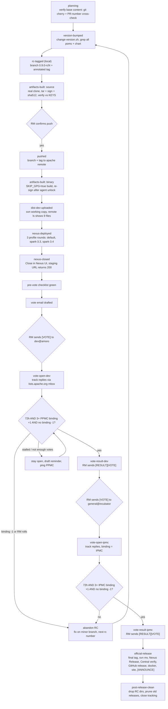

<!--
  Licensed to the Apache Software Foundation (ASF) under one or more
  contributor license agreements.  See the NOTICE file distributed with
  this work for additional information regarding copyright ownership.
  The ASF licenses this file to You under the Apache License, Version 2.0
  (the "License"); you may not use this file except in compliance with
  the License.  You may obtain a copy of the License at

    http://www.apache.org/licenses/LICENSE-2.0

  Unless required by applicable law or agreed to in writing, software
  distributed under the License is distributed on an "AS IS" BASIS,
  WITHOUT WARRANTIES OR CONDITIONS OF ANY KIND, either express or
  implied.  See the License for the specific language governing
  permissions and limitations under the License.
-->

# Amoro Release

## Overview

Use this skill for Apache Amoro (incubating) release-manager work. Treat a
release as a state machine with externally visible legal and distribution
effects, not as an ordinary CI chore.

Amoro is a podling: every release needs two successful votes (PPMC on
`dev@amoro.apache.org`, then IPMC on `general@incubator.apache.org`), version
strings carry the `-incubating` suffix in artifacts but not in RC git tags, and
distribution lives under `dist/incubator/amoro`.

Sources of truth to re-read in the current checkout before each phase:

- The project release guide: `https://amoro.apache.org/release-guide/`
- The validation guide: `https://amoro.apache.org/validate-release/`
- Version bump tooling: `tools/change-version.sh`
- Release artifact scripts: `tools/releasing/create_source_release.sh`,
  `tools/releasing/create_binary_release.sh`,
  `tools/releasing/deploy_staging_jars.sh`

## RM Environment (One-Time Setup)

Before the first release on a machine, verify or configure the following.
Everything here is one-time; re-verify cheaply at each release.

- **JDK 11**: `java -version` reports 11.x, and
  `JAVA_HOME=$(/usr/libexec/java_home -v 11)` resolves.
- **gh CLI**: `gh auth status` is logged in with push rights to
  `apache/amoro`.
- **SVN**: one interactive login caches credentials under
  `~/.subversion/auth`; afterwards `svn commit --non-interactive` works
  headless.
- **Maven deploy credentials**: `~/.m2/settings.xml` contains the
  `apache.releases.https` server (username + password encrypted via
  `mvn --encrypt-password` with the master password in
  `~/.m2/settings-security.xml`) and an `apache-release` profile setting
  `gpg.keyname` to the RM's signing key id. If `settings-security.xml`
  already exists from a previous cycle, reuse its master password — do not
  regenerate it.
- **GPG signing headlessly — measured reality, follow in this order**:
  1. Maven does NOT decrypt encrypted values in profile properties: an
     encrypted `gpg.passphrase` in settings.xml is used as a literal
     passphrase and every signature fails. Verified empirically with
     `mvn help:evaluate`.
  2. `gpg-preset-passphrase` is unreliable on GnuPG 2.5.x with keyboxd
     (preset reports success, `KEYINFO` shows no cache). Do not depend on
     it.
  3. The reliable paths are: the RM unlocks the agent once in their own
     terminal (`echo test | gpg --clearsign > /dev/null`; cache ~10
     minutes by default), or the long signing-heavy command (the Nexus
     deploy) runs in the RM's terminal where the first pinentry prompt
     appears once and the agent cache keeps refreshing on every subsequent
     signature.
  4. Optional `~/.gnupg/gpg-agent.conf` tuning:
     `allow-preset-passphrase`, `default-cache-ttl 3600`,
     `max-cache-ttl 86400`, then `gpg-connect-agent reloadagent /bye`.
- Never put passwords or passphrases in chat, shell history, or files in
  plaintext. Encryption happens in the RM's terminal; the agent only
  verifies structure, never reads secrets back.

## Ground Rules

- Use `gh` for GitHub PRs, issues, tags, and Actions logs. Checkouts may have
  several remotes; resolve the remote that points to `apache/amoro` instead of
  assuming it is named `origin`.
- Do not use web search for repository state. Query live GitHub, SVN
  (`https://dist.apache.org`), Nexus (`https://repository.apache.org`),
  `https://lists.apache.org`, and Maven Central URLs directly.
- Do not claim any step succeeded until the external system confirms it. For
  example, "uploaded" means `svn commit` returned a revision and `svn ls`
  shows the files; "vote passed" means the result email is written and the
  counted votes satisfy the rules.
- Treat an RC as bound to its tag, target commit, and generated artifacts. The
  `0.9.x` branch advancing after tagging does not invalidate an open RC.
- Never conflate Nexus `Close` (pre-vote) with Nexus `Release` (after the IPMC
  vote passes).
- Emails are drafted by the agent, sent by the human release manager from
  their Apache mail setup. Never send mail automatically. Track replies and
  count votes through `https://lists.apache.org`.
- Vote email subjects must start with `[VOTE]`. Deviating from the prefix
  hurts mail filtering and has correlated with stalled votes.
- Do not put SVN, Nexus, or mail credentials in commands, files, or PR text.
  Usernames may come from environment variables (`SVN_USER`, `NEXUS_USER`),
  but passwords must come from the operating-system credential cache or a
  human prompt. Never expand a password into command-line arguments. See the
  Subversion credential-cache documentation:
  `https://svnbook.red-bean.com/en/1.8/svn.serverconfig.netmodel.html#svn.serverconfig.netmodel.credcache`
  and curl's warning for `--user`:
  `https://curl.se/docs/manpage.html#-u`.
- Run all release compilation and deployment on JDK 11 (`java -version` must
  report 11.x). The Trino module requires JDK 17 and is excluded from
  releases by default via `skip-build-mixed-format-trino=true`; never enable
  `-Pbuild-mixed-format-trino` during release work.
- Pushing to the apache remote (branches, tags) is public and, by
  convention, irreversible for RC tags. Pushing is a built-in step of the
  flow, gated by one explicit RM confirmation: propose the exact push
  commands, get a clear yes, then execute without further prompting.
- Commit messages and public release text must not include agent attribution.
- Do not start a vote with broken links, an open Nexus staging repo, missing
  source artifacts, or a wrong signer attribution in the email.

## Version Scope Rules

A release cycle has three version identifiers. Keep them explicit and never
derive one from another:

- `release_version`: the ASF release version, for example `0.9.0-incubating`.
  Used in artifact filenames, Maven `<version>`, the Helm chart `appVersion`,
  SVN dist directories, vote email titles, and the final git tag
  (`v0.9.0-incubating`).
- `rc_tag`: the RC identifier, for example `v0.9.0-rc5`. Git tags for RCs
  carry no `-incubating` suffix. The RC branch pushed to the apache remote has
  the same name without the leading `v` (`0.9.0-rc5`).
- `rc_dir`: the SVN directory name, for example `0.9.0-incubating-RC5`
  (uppercase `RC`, includes the suffix).

The long-lived minor branch is `0.9.x`. Between RCs its poms sit at
`0.9.0-SNAPSHOT`; the RC version-bump commit changes them to
`0.9.0-incubating`. After an RC is abandoned, later backports land on
`0.9.x` with the pom still at `0.9.0-SNAPSHOT`, and the next RC bumps again.

Historical note: the final tag of a release keeps the suffix
(`v0.8.1-incubating`), while RC tags do not (`v0.8.1-rc1`).

## Release State Model

Report status using these states explicitly:

1. `planning`: backports are being cherry-picked to the minor branch; no
   version bump yet.
2. `version-bumped`: pom versions and Helm chart `appVersion` changed to
   `release_version` in a commit on the minor branch.
3. `rc-tagged`: RC branch and annotated tag created locally on the bump
   commit; pushed to the apache remote after artifacts are built and
   verified, with one explicit RM confirmation.
4. `artifacts-built`: `create_source_release.sh` and
   `create_binary_release.sh` produced the tarballs, signatures, and
   checksums locally.
5. `dist-dev-uploaded`: artifacts committed to
   `https://dist.apache.org/repos/dist/dev/incubator/amoro/${rc_dir}/`.
6. `nexus-closed`: Maven staging repo deployed with
   `deploy_staging_jars.sh`, closed in Nexus, and its public URL returns 200.
7. `vote-open-dev`: `[VOTE]` email sent to `dev@amoro.apache.org`.
8. `vote-result-dev`: at least 72 hours elapsed, at least 3 PPMC binding +1,
   no PPMC binding -1; `[RESULT][VOTE]` email sent.
9. `vote-open-ipmc`: `[VOTE]` email sent to `general@incubator.apache.org`.
10. `vote-result-ipmc`: at least 72 hours elapsed, at least 3 IPMC binding
    +1, no IPMC binding -1; `[RESULT][VOTE]` email sent.
11. `official-release`: final tag pushed, dist artifacts moved to
    `dist/release`, Nexus `Release` done, Maven Central synced, GitHub
    release created, Docker images verified, website updated, announcement
    sent.
12. `post-release-clean`: abandoned RC directories removed from dist/dev,
    old releases pruned from dist/release, tracking issue closed.

If an RC fails at any state before `official-release`, abandon it, keep the
fix work on the minor branch, and create the next RC. Do not move or rewrite
an existing RC tag.

## End-To-End Flow

The state model above is the reporting vocabulary; this flow is the
execution map. Diamonds are the three human gates where the agent stops and
the release manager acts; everything else is agent-executable.



Phase-by-phase runbook (empirical timings from the 0.9.0 RC5 cycle on a
warm local Maven cache):

| # | Phase (state) | What runs | Verified by | Typical time | Human gate |
|---|---------------|-----------|-------------|--------------|------------|
| 1 | planning | base-content check (`git cherry -v` + PR-number cross-check, see Start A Release) | every minor-branch-only fix has a counterpart on the base | minutes | RM picks the base |
| 2 | version-bumped | `tools/change-version.sh` (edit OLD/NEW first) | `grep` shows no SNAPSHOT stragglers; chart `appVersion` updated | minutes | — |
| 3 | rc-tagged (local) | `git branch 0.9.0-rcN` + `git tag -a v0.9.0-rcN` | `git ls-remote` shows no tag/branch conflict | seconds | — |
| 4 | artifacts (source) | real clone; `create_source_release.sh` | `gpg --verify` vs KEYS; `shasum -a 512 -c`; tar content spot-check | ~1 min | — |
| 5 | push | push branch + tag to the apache remote | `git ls-remote` shows both refs | seconds | **RM confirms push** |
| 6 | artifacts (binary) | `create_binary_release.sh` with `SKIP_GPG=true`, then re-sign both tarballs | `Good signature` ×2 | ~5 min warm cache | GPG unlock before re-signing |
| 7 | dist-dev-uploaded | stage in `~/amoro_svn/dev/amoro`, `svn commit` | committed revision + `svn ls` shows 9 files | 642 MB ≈ 45 min on a slow uplink | — |
| 8 | nexus-deployed | 3 deploy rounds (default / `-Pspark-3.3` / `-Pspark-3.4`) with `-Dmaven.javadoc.failOnError=false` | each log: BUILD SUCCESS, reactor contains the expected Spark variant, upload lines | 10–40 min per round | GPG unlock in RM terminal |
| 9 | nexus-closed | Close in the Nexus UI | staging URL returns HTTP 200 | minutes | **RM clicks Close** |
| 10 | pre-vote | checklist in its own section | all items green | minutes | — |
| 11 | vote-open-dev | agent drafts the email; RM sends | thread visible on lists.apache.org | ≥72 h | **RM sends `[VOTE]`** |
| 12 | vote-result-dev | agent counts votes; RM sends result | counted binding votes recorded | — | **RM sends `[RESULT][VOTE]`** |
| 13 | vote-open-ipmc | same on `general@incubator` | ≥72 h, ≥3 IPMC binding +1 | ≥72 h | **RM sends `[VOTE]`** |
| 14 | vote-result-ipmc | result email | counted IPMC votes recorded | — | **RM sends `[RESULT][VOTE]`** |
| 15 | official-release | final tag, `svn mv` to dist/release, Nexus `Release`, Central propagation check, GitHub release, docker images, site update, announcement | tag on remote; `svn ls` release dir; Central version query returns the release; Docker Hub carries the tag | ~1 h active + ~24 h Central sync | RM sends `[ANNOUNCE]` |
| 16 | post-release-clean | `svn del` RC dirs and old releases; close tracking issue | dev dir clean; downloads page current | minutes | — |

## Start A Release

1. Verify context:
   - The apache remote is resolved: `git remote -v | grep 'apache/amoro'`.
   - The minor branch tip and recent backports are known:
     `git log --oneline apache_remote/0.9.x -20`.
   - Existing RC tags and branches are listed with their target commits.
   - The release manager confirms which backports must be included.
   - If the RC will be cut from a base other than the minor branch (for
     example from `master`, as done for 0.9.0 RC5), verify the base is a
     content superset of the minor branch first:

     ```bash
     git cherry -v apache_remote/0.9.x apache_remote/master | grep "^+"
     ```

     Commits marked `+` are not patch-equivalent on the base — but do not
     conclude they are missing: cherry-picks and backports have different
     SHAs and patch contexts, so `git cherry` over-reports. Cross-check
     every `+` commit's PR number against the base branch log
     (`git log apache_remote/master --grep "#<PR>"`). In the 0.9.0 cycle
     all eight `+` commits turned out to be present on master under their
     original PR SHAs. Only genuinely missing fixes need cherry-picking
     before cutting the RC.
2. Read the current release guide and the three `tools/releasing/` scripts in
   the checkout (they occasionally change between releases).
3. Determine versions:
   - `release_version` (for example `0.9.0-incubating`)
   - next RC number: use the next integer only when the previous RC was
     abandoned because of failed artifacts, a failed vote, or the release
     manager explicitly wants additional commits included.
4. Verify the RM's GPG key is in KEYS before signing anything:
   `curl -s https://downloads.apache.org/incubator/amoro/KEYS | grep -i "<apache id>"`.
   The KEYS file in SVN `dist/dev` and `dist/release` must both contain the
   signing key. If it is missing, add it and commit before building.

## Version Bump

The bump script has hard-coded `OLD`/`NEW` variables at the top. Edit them
(`OLD="0.9.0-SNAPSHOT"`, `NEW="0.9.0-incubating"`), then run from `tools/`:

```bash
cd tools && bash change-version.sh
```

Then verify the bump is complete — partial bumps have cost this project RCs:

```bash
grep -rn "0.9.0-SNAPSHOT" --include=pom.xml . | grep -v target
grep -n "appVersion" charts/amoro/Chart.yaml
```

Both checks must come back clean before committing. The 0.9.0 cycle lost an
RC to a module pom the script run missed (`fix lance maven pom`), and an
earlier RC to an un-updated Helm chart `appVersion`. If any module pom is
still on the snapshot version, fix it manually in the same bump commit.

Commit on the minor branch, for example:

```bash
git checkout -b 0.9.x-tmp apache_remote/0.9.x   # or work on 0.9.x directly
# ... bump ...
git add -A && git commit -m "Change project version to ${release_version}"
```

## RC Tagging

Before tagging:

- The version-bump commit is on the minor branch.
- No existing tag uses the intended RC version:
  `git ls-remote --tags apache_remote "v0.9.0-rc5"`.

Create the RC branch and the annotated tag locally (Amoro tags are
annotated, not GPG-signed; the tagger identity is the RM's git identity):

```bash
git branch "0.9.0-rc5" "${minor_sha}" 2>/dev/null || true
git tag -a "v0.9.0-rc5" "${minor_sha}" -m "Release Apache Amoro ${release_version} rc5"
```

Then build and verify the artifacts (next two sections). Only after the
artifacts verify, push the branch and the tag to the apache remote —
this push is part of the flow and needs exactly one explicit RM
confirmation (show the two commands, get a yes, execute):

```bash
git push apache_remote "refs/heads/0.9.0-rc5"
git push apache_remote "refs/tags/v0.9.0-rc5"
```

Never move or rewrite a pushed RC tag. If a commit lands on the minor
branch after tagging and the RM wants it included, create the next RC.

## Build Artifacts

Run from a checkout of the RC tag, with `RELEASE_VERSION` exported. The
scripts must be invoked from the `tools/` directory. Build from a real
clone, not a linked git worktree — `create_binary_release.sh` enables
`-Pfail-on-no-git-dir` and the git-commit-id-plugin cannot read a
worktree's `.git` file (see failure patterns):

```bash
git clone <rc-checkout> /tmp/amoro-${rc_tag}-build
cd /tmp/amoro-${rc_tag}-build
git checkout "v0.9.0-rc5"
cd tools
RELEASE_VERSION="${release_version}" bash releasing/create_source_release.sh
RELEASE_VERSION="${release_version}" bash releasing/create_binary_release.sh
```

If the GPG agent passphrase is not cached, run the binary build with
`SKIP_GPG=true` and sign the tarballs manually right after an unlock,
instead of letting the script hang on a missing tty:

```bash
RELEASE_VERSION="${release_version}" SKIP_GPG=true bash releasing/create_binary_release.sh
# after unlocking the GPG agent:
gpg --armor --detach-sign apache-amoro-${release_version}-bin-hadoop3.tar.gz
gpg --armor --detach-sign apache-amoro-${release_version}-bin-hadoop2.tar.gz
```

The frontend build needs no system Node or pnpm: `amoro-web` provisions
node v18.18.0 and pnpm 9.6.0 itself via frontend-maven-plugin. The
`-Phadoop3` "profile could not be activated" warning from the script is
harmless — hadoop3 is the default build; only `hadoop2` is a real profile.

Outputs land in `tools/releasing/release/`. Verify the expected file set —
three tarballs, each with `.asc` and `.sha512`:

```bash
ls -l tools/releasing/release/
# apache-amoro-${release_version}-src.tar.gz{,.asc,.sha512}
# apache-amoro-${release_version}-bin-hadoop2.tar.gz{,.asc,.sha512}
# apache-amoro-${release_version}-bin-hadoop3.tar.gz{,.asc,.sha512}
```

Verify signatures and checksums locally before upload:

```bash
cd tools/releasing/release
curl -s https://downloads.apache.org/incubator/amoro/KEYS -o /tmp/KEYS
gpg --import /tmp/KEYS
gpg --verify apache-amoro-${release_version}-src.tar.gz.asc
shasum -a 512 -c apache-amoro-${release_version}-src.tar.gz.sha512
```

The `.asc` files must be signed by the RM's key, and the vote email must
attribute the signature to that same Apache ID. A previous cycle's vote emails
carried a stale "Apache ID: taowang" attribution after the RM changed —
regenerate the email from the actual signer, never from an old email.

## Upload To ASF SVN dist/dev

Use the persistent local working copy `~/amoro_svn/dev/amoro` (this matches
the release guide and keeps KEYS plus every previous RC directory available
locally). If it does not exist yet, create it once:

```bash
svn co https://dist.apache.org/repos/dist/dev/incubator/amoro ~/amoro_svn/dev/amoro
```

Then upload the artifacts:

```bash
cd ~/amoro_svn/dev/amoro
svn update
mkdir "${rc_dir}"
cp ${ARTIFACT_DIR}/apache-amoro-${release_version}-* "${rc_dir}/"
svn add "${rc_dir}"
svn status
svn commit -m "Prepare Apache Amoro ${rc_dir}" \
  --username "$SVN_USER" --non-interactive
svn ls "https://dist.apache.org/repos/dist/dev/incubator/amoro/${rc_dir}/"
```

Stop rules:

- A source release that lacks `apache-amoro-${release_version}-src.tar.gz`
  is invalid under ASF policy (`https://infra.apache.org/release-publishing.html#valid`).
  The 0.9.0 RC3 vote was cancelled for exactly this. Never open a vote
  without the source tarball present.
- If `svn commit` fails with `E215004 Authentication failed`, treat it as an
  auth blocker, not an artifact blocker.
- If the cached credential is missing or rejected, stop automation and ask the
  RM to refresh it with one interactive SVN operation in their own terminal.
  Never fall back to `--password` or another password-bearing command argument.
- Do not say "uploaded" until the final `svn ls` shows all nine files.

## Deploy And Close Nexus Staging

The staging repository must contain the complete engine matrix: every Spark
variant (3.3, 3.4, 3.5), every Flink variant (1.18, 1.19, 1.20), and all
other modules. Trino is excluded — under JDK 11 it is skipped automatically
by the `skip-build-mixed-format-trino=true` default.

The build system supports exactly ONE Spark major version per reactor run:
`spark.version` and `spark.major.version` are root-pom properties set by the
`spark-3.3`/`spark-3.4`/`spark-3.5` profiles (default 3.5), and the
versioned modules neither pin their own Spark version nor appear
unconditionally in the module list. Flink variants (v1.18/v1.19/v1.20) are
unconditional, so one run covers them all. Therefore the matrix needs three
deploy invocations through the script's `CUSTOM_OPTIONS` passthrough:

```bash
cd tools
# run 1: default (Spark 3.5 + all Flink + everything else)
CUSTOM_OPTIONS="-Dmaven.javadoc.failOnError=false" \
  RELEASE_VERSION="${release_version}" bash releasing/deploy_staging_jars.sh
# run 2 and 3: the other Spark variants
CUSTOM_OPTIONS="-Pspark-3.3 -Dmaven.javadoc.failOnError=false" \
  RELEASE_VERSION="${release_version}" bash releasing/deploy_staging_jars.sh
CUSTOM_OPTIONS="-Pspark-3.4 -Dmaven.javadoc.failOnError=false" \
  RELEASE_VERSION="${release_version}" bash releasing/deploy_staging_jars.sh
```

All runs deploy into the same open staging repository; re-deploying the
common modules is harmless (verified in the 0.9.0 cycle). A faster
alternative for follow-up runs is direct maven with `-pl` on the two
versioned artifacts plus `-am`.

`-Dmaven.javadoc.failOnError=false` is required: the Spark engine modules
are mixed Java/Scala, and `attach-javadocs` cannot resolve Scala-defined
symbols (`MixedFormatSpark35Helper`, `SparkInternalRowCastWrapper`,
`RowDeltaUtils`), so javadoc fails on modules whose javadoc is otherwise
fine to skip. After each run, verify the reactor actually contained the
expected Spark variant:

```bash
grep -cE "Building Amoro Project Mixed Format Spark 3\.[34]" /tmp/rc5-deploy-spark33.log
```

Stop rules:

- Do not try to list all Spark version modules in the mixed-spark parent
  pom to force a single-run matrix: the versioned modules inherit
  `spark.version` from the root (default 3.5.8), so v3.3/v3.4 compile
  against the wrong Spark and fail with ~86 Scala errors. Verified the
  hard way in the 0.9.0 RC5 cycle.
- Deploy from a tree with no generated artifacts in
  `tools/releasing/release/` (RAT failure, see below) and `git status`
  clean.
- Wrap the whole deploy in one self-contained command block (matrix-free,
  log to file, verify grep, restore nothing). Running an older command
  from shell history after the tree was restored silently deploys the
  wrong module set.

Find the staging repository id (form `orgapacheamoro-<number>`, for example
`orgapacheamoro-1079`) in the deploy output or at
`https://repository.apache.org/` under Staging Repositories. Close the
repository in the UI, then verify it is publicly exposed:

```bash
curl -sS -o /dev/null -w '%{http_code}\n' \
  "https://repository.apache.org/content/repositories/orgapacheamoro-${n}/"
```

Stop rules:

- `404` means not vote-ready. Distinguish "repo exists but open" from a wrong
  repo id by opening the URL and reading the body.
- `Close` is pre-vote. `Release` is post-vote. Never trigger `Release`
  before the IPMC vote passes.
- If a vote fails, drop the staging repository.

## Pre-Vote Readiness Checklist

Run this immediately before drafting the vote email. Do not open a vote with
any item failing:

- RC tag `v0.9.0-rc5` exists on the apache remote and points at the bump
  commit; the RC branch exists too.
- `git show v0.9.0-rc5:pom.xml` shows `${release_version}`; no pom in the
  tag still references `0.9.0-SNAPSHOT`.
- `charts/amoro/Chart.yaml` `appVersion` at the tag equals
  `${release_version}`.
- `svn ls` on the RC directory shows all nine files (src + bin-hadoop2 +
  bin-hadoop3, each with `.asc` and `.sha512`).
- Signatures verify against KEYS; the signer is the RM and KEYS contains
  that key.
- Nexus staging URL returns 200 and the repo is closed.
- Vote email subject starts with `[VOTE]` and the signer attribution
  matches the actual `.asc` signer.

## Start The dev@ Vote (PPMC)

Draft the email for the human RM to send to `dev@amoro.apache.org`. Use the
rc4-era body as the base template, with the subject fixed to the standard
form:

- Subject: `[VOTE] Release Apache Amoro (incubating) ${release_version} RC5`
- Body: one-paragraph context (what changed since the last RC and why),
  then the links:
  - Artifacts: `https://dist.apache.org/repos/dist/dev/incubator/amoro/${rc_dir}/`
  - KEYS: `https://downloads.apache.org/incubator/amoro/KEYS`
  - Maven staging: `https://repository.apache.org/content/repositories/orgapacheamoro-${n}/`
  - Git tag: `https://github.com/apache/amoro/tree/v0.9.0-rc5`
  - Site: `https://amoro.apache.org/`
  - Vote rules text: open at least 72 hours; passes with at least 3 binding
    +1 from Amoro PPMC members and no binding -1.
  - Ballot lines (`[ ] +1 / +0 / -1`) and the validation checklist
    (links valid; checksums and signatures; LICENSE/NOTICE/DISCLAIMER;
    no unexpected binaries; ASF headers; builds from source).

## Track And Count Votes

Votes are tracked from the public list archives, not from memory:

```bash
curl -s "https://lists.apache.org/api/mbox.lua?list=dev@amoro.apache.org&date=YYYY-MM" -o /tmp/amoro-dev.mbox
```

Then parse the mbox for the vote thread (match on the exact subject, include
`Re:` replies), extract `+1` / `+0` / `-1` with sender addresses, and
classify:

- Binding on dev@: Amoro PPMC members. The roster is on
  `https://incubator.apache.org/projects/amoro.html`. Known PPMC addresses
  from the 0.9.0 cycle include `czy006@apache.org`, `xuba@apache.org`,
  `jinsongzhou@apache.org`, `klion26@apache.org`, `taowang@apache.org` —
  re-verify against the roster page, it changes.
- A binding `-1` blocks the release. Reply asking for the issue link, fix on
  the minor branch, abandon the RC, create the next one. This is how the
  0.9.0 rc2 vote ended (fatal bug `apache/amoro#4223`).
- If a reply's sender is not on the roster, mark the vote non-binding and
  confirm with the RM rather than guessing.

Timing:

- The vote must stay open at least 72 hours from the vote email's Date
  header. Record that timestamp when the email is sent.
- Do not declare a result because votes "look promising". Count replies
  explicitly.

If a vote stalls with no replies for several days (the rc4 vote sat a month
with zero replies), draft a short reminder/ping for the RM to send to
dev@, and suggest directly pinging PPMC members off-list. Include the
pending backport list in the next RC if the cycle restarts.

## dev@ Vote Result

When the rules are met, draft for the RM to send:

- Subject: `[RESULT][VOTE] Release Apache Amoro (incubating) ${release_version} RC5`
- Body: the vote thread URL, per-voter list split into binding +1 / non-binding +1 /
  +0 / -1, and the conclusion.

Do not proceed to the IPMC vote before this result email is out.

## IPMC Vote (general@incubator)

The second, governing vote. Draft for the RM to send to
`general@incubator.apache.org`:

- Subject: `[VOTE] Release Apache Amoro (incubating) ${release_version}`
- Body: same links as the dev@ vote, plus a short recap of the dev@ vote
  result (votes counted, thread link), and a note that this is a podling
  release following the two-vote process.
- Rules: at least 72 hours, at least 3 binding +1 from IPMC members, no
  binding -1. IPMC membership is not the same as PPMC membership; classify
  senders against IPMC (mentors of the podling are IPMC members; when unsure
  about a sender, mark unknown and confirm).

Track with the same mbox flow against
`list=general@incubator.apache.org`. After it passes, send the
`[RESULT][VOTE]` to general@incubator.

## Official Release

After the IPMC result email:

1. Push the final tag at the approved RC's commit:

```bash
git tag -a "v${release_version}" "${rc_commit}" -m "Release Apache Amoro ${release_version}"
git push apache_remote "v${release_version}"
```

2. Move SVN artifacts from dev to release (RC suffix dropped):

```bash
svn mv https://dist.apache.org/repos/dist/dev/incubator/amoro/${rc_dir} \
  https://dist.apache.org/repos/dist/release/incubator/amoro/${release_version} \
  -m "Release Apache Amoro ${release_version}" \
  --username "$SVN_USER" --non-interactive
svn ls https://dist.apache.org/repos/dist/release/incubator/amoro/${release_version}/
```

3. Release the Nexus staging repo. This is a credentialed, irreversible
   operation: the RM performs it interactively in the Nexus UI through Staging
   Repositories → select `orgapacheamoro-${n}` → Release. Do not automate it
   with `curl --user user:password`; curl documents that command-line
   credentials can be observed briefly in process listings:
   `https://curl.se/docs/manpage.html#-u`.

Maven Central sync takes up to ~24 hours. Verify with a version-specific
query, for example
`https://search.maven.org/solrsearch/select?q=g:org.apache.amoro+AND+v:${release_version}`,
or the `amoro-ams` artifact on `https://repo1.maven.org/maven2/org/apache/amoro/`.

Do not skip this verification: the 0.8.0-incubating and 0.8.1-incubating
releases passed their votes and shipped from dist.apache.org, but their
staging repositories were never released — Maven Central still stops at
0.7.1-incubating for `org.apache.amoro`. Until this gap is backfilled, every
new release must confirm the Central propagation explicitly.

4. Docker images: the `docker-images.yml` workflow builds on tag pushes.
   Verify `apache/amoro` and the optimizer images carry the new tag on
   Docker Hub once the runs complete (`gh run list --repo apache/amoro --limit 10`).

5. Create the GitHub release for `v${release_version}` with generated notes
   (`.github/release.yml` categorizes them).

6. Website: submit a PR to the amoro site repository with the new version
   (mind the `hugo.toml` url/branch mapping), merge, then create and push the
   version branch so `deploy.yml` runs. Verify the download page references
   the ASF artifacts.

## Announcements

Draft for the RM to send (plain text, from the committer mail setup, no agent
attribution):

- To `dev@amoro.apache.org` and `general@incubator.apache.org`
- Subject: `[ANNOUNCE] Apache Amoro (Incubating) ${release_version} available`
- Body: a short notable-changes summary and the official download URL
  (`https://amoro.apache.org/download/` or the downloads.apache.org path).

## Post Release

- Delete this cycle's abandoned RC directories from dist/dev (and older
  leftovers from previous cycles — `0.7.0-RC1`, `0.7.1-RC1`, `0.8.0-RC2`
  have been lingering):

```bash
svn del -m "Clean up RC for ${release_version}" \
  "https://dist.apache.org/repos/dist/dev/incubator/amoro/${rc_dir}"
```

- Prune old releases from dist/release per ASF policy (downloads.apache.org
  serves only the current release of each line; delete older ones with
  `svn del`).
- Verify `https://downloads.apache.org/incubator/amoro/` serves the new
  release.
- Close or update the release tracking issue/discussion.
- Record any process failure that cost an RC as a durable fix (script or doc
  PR), not just a note.

## Common Failure Patterns

### Missing source tarball in the RC directory

RC3 of 0.9.0 was voted down because the dist/dev directory did not contain
the `-src.tar.gz`. ASF releases are source releases; binaries are
convenience. The pre-vote checklist blocks this now — never skip it.

### Partial version bump

One RC was cut with a module pom still on the snapshot version, and another
with a stale Helm chart `appVersion`. After `change-version.sh`, always grep
every pom and the chart before tagging.

### Binding -1 during the vote

rc2 of 0.9.0 drew a binding -1 for a fatal bug (`apache/amoro#4223`).
Cancel the vote, acknowledge in the next RC's vote email, fix on the minor
branch, cut the next RC.

### Vote stalls with zero replies

rc4 sat a month without a single reply. Contributing factors: a non-standard
subject ("Vote Releasing..." instead of "[VOTE] ..."), and a two-month gap
since the previous RC. Mitigations: keep the standard `[VOTE]` subject, send
reminder drafts, ping PPMC members directly, and if restarting, say clearly
in the new vote email what changed since the stalled RC.

### Stale signer attribution in the vote email

Vote emails in the 0.9.0 cycle said "signed with a PGP ... (Apache ID:
taowang)" while artifacts were signed by the new RM. Readers cannot verify
signatures from a wrong attribution. Generate the signer line from the
actual `.asc` and KEYS content.

### Nexus staging left open, or released early

`Close` before the dev@ vote; `Release` only after the IPMC vote passes. A
404 on the staging URL while drafting the vote email means the repo is not
closed yet.

### SVN authentication hangs on macOS Keychain

Interactive prompts may not reach the agent process. Stop automation and ask
the RM to unlock or refresh the Keychain-backed credential with an interactive
SVN operation in their own terminal, then retry the documented non-interactive
command. Never pass a password through argv or an environment-expanded command.

### Release artifacts in the tree fail the RAT check

`deploy_staging_jars.sh` activates the `apache-release` profile, which runs
the Apache RAT license check over the whole checkout. Generated artifacts
under `tools/releasing/release/` (`.asc`, `.sha512`, tarballs) have no
license headers and fail RAT on the first module. Keep the deploy tree
clean: move finished artifacts out of the checkout (for example to
`/tmp/${rc_tag}-artifacts/`) before deploying, and let the deploy run from
a tree where `git status --porcelain` is empty except the temporary mixed
spark pom change.

### git-commit-id-plugin fails in a worktree

Building the binary release from a linked git worktree fails on the
`amoro-ams` module: `git-commit-id-plugin` cannot resolve HEAD from a
worktree's `.git` file, and the build script enables
`-Pfail-on-no-git-dir`. Always build from a real `git clone` of the RC
checkout. Related: do not pipe the build scripts through `tail` — the
pipeline masks the real exit code; redirect to a log file and echo `$?`.

### RC tag already exists

Never reuse or move an RC tag, even for the same commit. If
`v0.9.0-rc5` already exists, the next attempt is `v0.9.0-rc6` or an
explicitly abandoned-and-recreated cycle with a new number.
