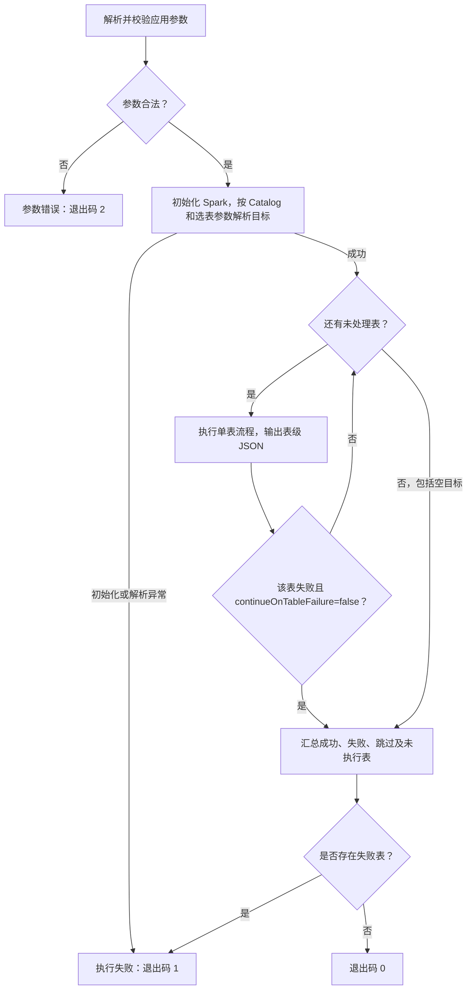
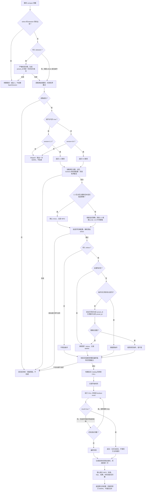

<!--
 - Licensed to the Apache Software Foundation (ASF) under one or more
 - contributor license agreements.  See the NOTICE file distributed with
 - this work for additional information regarding copyright ownership.
 - The ASF licenses this file to You under the Apache License, Version 2.0
 - (the "License"); you may not use this file except in compliance with
 - the License.  You may obtain a copy of the License at
 -
 -   http://www.apache.org/licenses/LICENSE-2.0
 -
 - Unless required by applicable law or agreed to in writing, software
 - distributed under the License is distributed on an "AS IS" BASIS,
 - WITHOUT WARRANTIES OR CONDITIONS OF ANY KIND, either express or implied.
 - See the License for the specific language governing permissions and
 - limitations under the License.
 -->

# Amoro Lakehouse Producer

`amoro-producer` 提供统一的 Lakehouse Producer 入口：
`org.apache.amoro.producer.LakehouseProducer`。

当前支持 Paimon format，提交任务时必须指定：

- `--format paimon`
- `--action <action>`
- `--catalogName paimon`

`--catalogName` 的默认值是 `spark_catalog`。Paimon 生产脚本必须显式传入
`--catalogName paimon`，该参数用于整库扫描、`$options` 读取和 catalog-qualified
procedure 调用。

## 编译与打包

在仓库根目录按部署环境选择一套组合；这些 profile 仅配置 `amoro-producer`，不改变其他模块的版本。

```bash
# Spark 3.2.1 + Paimon 0.9.0
./mvnw -pl amoro-producer clean package -Pproducer-paimon-0.9.0 -DskipTests

# Spark 3.5.4 + Paimon 1.3.2（默认组合，建议显式指定）
./mvnw -pl amoro-producer clean package -Pproducer-paimon-1.3.2 -DskipTests
```

切换组合必须使用 `clean`；不要同时启用两个 profile。`-DskipTests` 跳过测试执行，但仍编译测试代码。
编译选择与运行时 `--version` 是独立参数，提交时应使用匹配的 Spark 环境和 Paimon 运行包。

两套组合的打包产物路径相同，后一次构建会覆盖前一次；需要同时保留时，在切换前将产物复制并按版本命名：

```text
amoro-producer/target/amoro-producer-0.9-SNAPSHOT-jar-with-dependencies.jar
```

## 通用参数

| 参数 | 是否必填 | 默认值 | 说明 |
|------|----------|--------|------|
| `--format` | 是 | 无 | 表格式。Paimon 使用 `paimon`。 |
| `--action` | 是 | 无 | action 名称：`compact`、`compact-manifest`、`expire-snapshots`、`remove-orphan-files`。 |
| `--catalogName` | 否 | `spark_catalog` | Spark catalog 名称。Paimon 生产脚本应显式传 `paimon`。 |
| `--databaseName` | 否 | 无 | 数据库名。仅传该参数时，扫描该库下全部非临时表。 |
| `--tableName` | 否 | 无 | 表名。与 `--databaseName` 同时传入时只允许简单表名；单独传入时必须是 `db.table`。 |
| `--tableNameRegex` | 否 | 无 | 整库模式表名过滤正则，仅支持 `--databaseName` 且未指定 `--tableName`。 |
| `--retryTimes` | 否 | `3` | 最大尝试次数，包含首次执行。 |
| `--continueOnTableFailure` | 否 | `true` | 单表失败后是否继续；存在失败表时最终仍返回非零退出码。 |
| `--help` / `-h` | 否 | 无 | 打印帮助信息。 |

退出码：有失败表或执行异常为 `1`，参数错误为 `2`，仅成功/跳过或无匹配表为 `0`。
`continueOnTableFailure=false` 在首个失败表后停止，并输出已执行部分的汇总；未执行表单独计数。
表级 JSON 保留原字段，并增加 `effectiveVersion` 和 `tasks`；任务内记录尝试次数、状态和错误信息。
这些共享退出码和汇总规则也适用于另外三个维护动作。

## compact

按目标表属性选择 SQL 路径，执行官方 Paimon `compact` procedure。每表读取一次 `$options`（读取失败可重试）；不在 Producer 内拆分 bucket。
对版本匹配的表，通过 Spark Catalog 一次加载真实主键列、分区列、Schema 和实际生效属性，包含 `spark.paimon.*` 全局、表级和通配配置，再叠加 Procedure options 进行范围能力检查。
原始属性读取、表元数据读取和 Procedure 执行各自最多尝试 `retryTimes` 次；任一读取耗尽即失败。合并重试复用已读取属性与同一范围条件，不叠加框架重试。

### 选择表与执行版本

| 目标 | 参数组合 | 实际范围 |
|---|---|---|
| 单张表 | `--databaseName ods --tableName orders` | 只处理 `ods.orders`；此时 tableName 必须是简单表名。 |
| 单张表，完整名称 | `--tableName ods.orders` | 不传 databaseName，同样只处理一张表。 |
| 整库 | `--databaseName ods` | 枚举该库中的非临时表，再逐表按属性和版本判定。 |
| 库内匹配表 | `--databaseName ods --tableNameRegex '^orders_.*'` | 正则匹配简单表名；不能同时传 tableName。 |

`--catalogName` 指定目标 Catalog，以上所有模式均显式使用该 Catalog。
表名筛选决定“处理哪些表”，`--where` 或 `--between` 提供待逐表适配的分区条件，最终条件取决于实际主键与分区定义。表名筛选可与其中一种范围参数组合使用，where 与 between 不能同时传入。

| 表属性 | `--version` | 执行行为 |
|---|---|---|
| `self-optimizing.enabled`、`write-only` 均为 `true` | `0.9`（含未传 version） | 返回 `Skipped`，输出 WARN，不调用合并 |
| `self-optimizing.enabled`、`write-only` 均为 `true` | `1.3` | 执行 1.3 SQL |
| 非双开关，包括缺失、关闭或只开启一个 | `0.9` | 执行 0.9 SQL |
| 非双开关 | `1.3` | 返回 `Skipped`，输出含 catalog、库名、表名和原因的 WARN |
| 属性读取异常 | 任意合法值 | 重试耗尽后失败，不降级为整表合并 |

这里的版本是执行路径标签，不是对数据文件版本的检测；`--version` 也不会切换运行时 JAR。
双开关值去除首尾空白后，不区分大小写判断 true；缺失或只开启一个都属于非双开关表。

### 合并参数与生效范围

| 参数 | 默认值 | 生效范围 | 说明 |
|------|--------|----------|------|
| `--version` | `0.9` | 表路由 | 仅支持 `0.9`、`1.3`；仅执行与表分类匹配的路径：0.9 跳过双开关表，1.3 跳过非双开关表。 |
| `--where` | 不传 | 两条路径 | 分区谓词，例如 `dt >= '2026-10-01' AND dt < '2026-10-08'`。整库模式逐表适配：主键移除条件，非主键保留适配条件，否则尝试 preset_dt→preset_pt，仍不适配则移除整个条件。空字符串或纯空白（含 Unicode 空白）报错；不传则不附加分区谓词，0.9 路径仍受空闲时间限制。 |
| `--between` | 不传 | 两条路径 | 日期快捷参数，例如 `2026-10-10` 自动生成 `preset_dt BETWEEN '2026-10-09' AND '2026-10-10'`，包含前一天和指定日期。与 `--where` 严格互斥；生成条件沿用相同逐表适配规则。 |
| `--compactStrategy` | 按表选择 | 仅 1.3 | 未显式传入时：真实主键列非空且无分区的表默认 `minor`，其他表默认 `full`。显式 `full` 或 `minor` 优先，传给 `compact_strategy`；0.9 路径不传此参数。 |
| `--procedureOptions` | `target-file-size=256m` | 仅 1.3 | 以 `k=v,k=v` 传给动态 options；空字符串表示不传。禁止开启 `write-only`；0.9 路径不使用此参数。 |
| `--partitionIdleTime` | `1h` | 仅 0.9 | 传给 `partition_idle_time`，与 where 共同筛选分区；可用 `0s` 不等待空闲时间。空字符串或纯空白报错；1.3 路径不传此参数。 |
| `--retryTimes` | `3` | 两条路径 | 必须大于 0。每个读取/执行阶段最多尝试指定次数（默认 3 次），包含首次执行；SQL 重试不扩大条件。 |
| `--continueOnTableFailure` | `true` | 多表编排 | true 继续处理剩余表，false 首个失败表后停止；两者只要存在失败表，最终退出码均为 1。 |

`--where` 与 `--between` 按是否显式传入判断互斥，同时传入（即使为空）会在创建 SparkSession 前报错，退出码为 2。
`--between` 允许首尾空白，仅接受真实有效的 `yyyy-MM-dd` 日期；跨月、跨年、闰年按自然日计算，输入及前一天的年份须在 0001..9999 内。
不支持 `today`、`yyyyMMdd` 或时间戳；两种范围参数均未传入时，不生成条件。

`--startBucket`、`--step` 已移除：显式传入会在执行前报错，需从旧脚本中删除。
官方 Paimon 1.3.2 没有 `buckets` 参数，本次不提供等价的 bucket 范围限制。

1.3 的默认策略在读取真实元数据后确定，不能根据 preset_dt/preset_pt 命名推断。无分区主键表未传 compactStrategy 时使用 minor；即使整库同时包含其他表，也逐表选择。
显式传入 `--compactStrategy full` 仍执行 full；空值或非法策略继续报错，不被默认规则覆盖。0.9 的 SQL、默认 1h 空闲时间及条件适配保持原有行为。
表级 metrics 的 requestedCompactStrategy 为显式值或 default，effectiveCompactStrategy 为实际值；完成回调 SQL 和所有重试均使用实际策略。

读取原始属性后先检查表分类与 version 是否匹配，不匹配时每表输出一次包含 Catalog、库名、表名及原因的 WARN，不加载生效属性、不调用 Procedure、不触发合并完成回调。匹配后才校验路径参数：1.3 使用 compactStrategy 和 procedureOptions，0.9 使用 partitionIdleTime。
全局参数错误返回 2；读取表后才能确定的路径参数错误计为该表失败，最终返回 1。

### 常见参数组合

以下是放在 JAR 路径之后的应用参数；Spark 资源、Catalog 和认证配置沿用部署环境。

```bash
# 双开关单表：不附加分区条件，按表选择默认策略，使用默认 256m options
--format paimon --action compact --catalogName paimon \
  --databaseName ods --tableName orders --version 1.3

# 双开关非主键单表：dt 确为分区列时只合并指定分区，选择 minor
--format paimon --action compact --catalogName paimon \
  --databaseName ods --tableName orders --version 1.3 \
  --where "dt >= '2026-10-01' AND dt < '2026-10-08'" \
  --compactStrategy minor --procedureOptions target-file-size=256m

# 非双开关旧路径非主键单表：dt 确为分区列时指定范围，不等待默认 1h 空闲时间
--format paimon --action compact --catalogName paimon \
  --databaseName ods --tableName orders --version 0.9 \
  --where "dt = '2026-10-01'" --partitionIdleTime 0s

# 旧路径日期快捷输入：候选日期包含 10 月 9 日、10 日，仍受默认 1h 空闲时间限制
--format paimon --action compact --catalogName paimon \
  --databaseName ods --tableName orders --version 0.9 --between 2026-10-10

# 双开关日期快捷输入：生成条件后按真实主键和分区定义适配
--format paimon --action compact --catalogName paimon \
  --databaseName ods --tableName orders --version 1.3 --between 2026-10-10

# 库内匹配表：仅执行双开关表，首个失败表后停止
--format paimon --action compact --catalogName paimon \
  --databaseName ods --tableNameRegex '^orders_.*' --version 1.3 \
  --retryTimes 3 --continueOnTableFailure false
```

第三个例子只处理非双开关表，遇到双开关表会跳过；不传 version 同样默认选择 0.9。
只有一个开关为 true 的表仍属于非双开关表，因此这不是“排除所有开启自动优化的表”的筛选。

完整提交示例：仅对双开关表执行合并，where 按每张表的主键和分区定义适配。

```bash
./spark-submit \
  --master yarn \
  --deploy-mode cluster \
  --conf spark.sql.catalog.paimon=org.apache.paimon.spark.SparkCatalog \
  --conf spark.sql.extensions=org.apache.paimon.spark.extensions.PaimonSparkSessionExtensions \
  --conf spark.sql.catalog.paimon.type=hive \
  --conf spark.sql.catalog.paimon.warehouse=hdfs://warehouse/paimon \
  --class org.apache.amoro.producer.LakehouseProducer \
  amoro-producer-0.9-SNAPSHOT-jar-with-dependencies.jar \
  --format paimon \
  --action compact \
  --version 1.3 \
  --catalogName paimon \
  --databaseName ods \
  --tableNameRegex '^ods_.*' \
  --where "dt >= '2026-10-01' AND dt < '2026-10-08'" \
  --compactStrategy full \
  --procedureOptions target-file-size=256m
```

所有 compact 调用都显式使用 `--catalogName`，不要求 Spark 默认 Catalog 与其相同。
要求 `spark.sql.parser.escapedStringLiterals=false`（Spark 默认值）；若开启旧字符串解析模式，
本动作会在提交合并前明确失败，不修改会话配置，也不冒险改变条件含义。
当 Catalog、库表名或实际使用的参数包含 `${...}` 时，还需显式配置
`spark.sql.variable.substitute=false`；否则会在执行前拒绝，避免 Spark 变量替换改变范围或动态 options。
条件中的 `${...}` 将作为原始文本传给 Paimon，不支持在 Producer 参数内展开 Spark 变量。

### 主键及分区条件适配

`--between` 生成的条件也使用下表规则；日志及回调的 requestedWhere 记录生成的谓词，effectiveWhere 记录最终条件。
主键表或分区不适配表会移除日期限制，preset_pt 替换仅改字段名、不转换日期值；零命中保持条件。
此规则同时适用于 0.9 和 1.3，并替代原先“始终保留用户 where”的行为。
主键与分区取自真实 Paimon 元数据，不根据字段命名判断；普通列 preset_dt 不等于分区列。

| 元数据与条件 | 最终 where | 决策标记 |
|---|---|---|
| 未传入 where | 不传 | `not-provided` |
| 主键列非空 | 移除用户条件 | `removed-primary-key` |
| 非主键表，条件仅引用实际分区列 | 原文保留 | `retained` |
| 非主键表，preset_dt 非分区列、preset_pt 是分区列，替换后条件适配 | 仅替换列引用，保留比较值和运算符 | `replaced-preset-dt` |
| 非主键表无分区，或替换后仍引用非分区列 | 移除整个条件，不保留其中部分子条件 | `removed-partition-mismatch` |

例如原条件为 `preset_dt = '2026-10-08' AND preset_hr = '08'`：
实际分区为 preset_dt+preset_hr 时原样保留；为 preset_pt+preset_hr 时只将 preset_dt 换为 preset_pt；
仅有 preset_pt 时，preset_hr 仍不适配，因此移除整个 where。
主键表即使有 preset_dt 分区，也不传 where。移除后仍受 0.9 的 partition_idle_time 限制（默认 1h）。

替换使用 Spark 表达式解析，仅改列引用，不会改字符串常量中的 preset_dt；遵循 Spark 大小写规则。
preset_pt 的值不会自动转换日期格式，因此替换后可能零命中；零命中不触发进一步移除条件。
SQL 语法错误、子查询、lambda、通配列或多段限定列等无法可靠适配的引用会在执行前失败；普通顶层列可使用反引号。
元数据读取失败不推断为无分区表。最终保留或改写的条件继续由 Spark/Paimon 校验，执行失败只重试相同 SQL。
未匹配到分区的正常调用可以成功，但不代表产生了文件重写。
官方 1.3.2 无分桶增量聚簇路径无法保证 `where` 过滤，因此最终 where 非空时该组合在执行前被拒绝；检查包含动态 options 覆盖后的配置。

1.3 路径按官方 1.3.2 契约构建。运行包必须与部署环境匹配；同一应用不会加载两套 Paimon 版本。
Producer 使用模块专属版本属性，不修改父 POM 或其他模块的 Spark/Paimon 版本。

| 构建选择 | Spark | Paimon | Spark Connector 坐标 |
|---|---|---|---|
| 默认 / `-Pproducer-paimon-1.3.2` | 3.5.4 | 1.3.2 | `org.apache.paimon:paimon-spark-3.5:1.3.2` |
| `-Pproducer-paimon-0.9.0` | 3.2.1 | 0.9.0 | `org.apache.paimon:paimon-spark-3.2:0.9.0` |

具体命令见上方“编译与打包”。

每次切换组合使用 `clean`，避免复用另一 Spark 版本的编译结果。两个 profile 不要同时启用。
Spark 依赖为 provided，由运行环境提供；所有 Producer Paimon 依赖使用同一版本。
保留旧 `-Dpaimon.version=0.9.0/1.3.2` 的 profile 激活方式，但推荐上面的模块 profile：
`-Dpaimon.version` 属于全局用户属性，在多模块构建时可能影响其他模块。
CLI `--version` 只选择执行路径，不选择编译依赖。
旧组合同时在本模块内使用 Spark 3.2 对应的 SLF4J 1.7 API；不会改变其他模块的日志依赖。

参考：[Paimon 1.3 procedures](https://paimon.apache.org/docs/1.3/spark/procedures/)、
[Paimon 0.9 procedures](https://paimon.apache.org/docs/0.9/spark/procedures/)、
[官方 1.3.2 CompactProcedure](https://github.com/apache/paimon/blob/release-1.3.2/paimon-spark/paimon-spark-common/src/main/java/org/apache/paimon/spark/procedure/CompactProcedure.java)、
[Spark 字符串字面量](https://spark.apache.org/docs/3.5.6/sql-ref-literals.html#string-literal)。

### 执行流程图

作业层先确定目标表，再按 continueOnTableFailure 决定是否继续；停止时仍输出已执行部分的汇总。



单表层按原始属性分类，再匹配 version；范围检查使用实际生效配置，只有提交过 CALL 的表才触发完成回调。



图中开始时间只在第一次 CALL 前记录；重试沿用该开始时间，总耗时覆盖全部尝试。
只有上述已确认的主键及分区适配规则可在调用前移除 where；读取失败、语法错误及执行异常不会触发删除条件重试。

### Spark UI 中的库表、策略及范围描述

执行每张表的 `CompactProcedure` 时，Spark Jobs 页的 Description 和时间线使用
`Compact table: <catalog>.<database>.<table> | strategy=<最终策略> | where=<最终条件>`，无需额外参数。
例如 `Compact table: paimon.ods.orders | strategy=full | where=preset_dt BETWEEN '2026-10-09' AND '2026-10-10'`。
1.3 显示最终实际使用的 full/minor；0.9 未传 compact_strategy，因此显示 native，表示沿用 Paimon 原生策略。
where 使用逐表适配后的最终条件；未提供条件或条件被移除时显示 ALL。preset_dt→preset_pt 替换后显示改写结果，敏感值按现有规则脱敏。
这是 Job 级描述，不是在每个 Task 上重复展示完整 SQL；完整展示 SQL 仍可从完成回调日志查看。
该描述覆盖本表合并及其重试，执行成功或失败后恢复原描述，再通知完成回调；元数据读取保留原描述。
Jobs 页仍可能在描述下方展示 `collect at CompactProcedure.java:...` 调用位置链接，便于排障。
新描述只影响更新应用后产生的作业，不会改写已有 Spark History 记录。

每张允许执行的表输出 `Compaction scope resolved` INFO；移除用户条件则输出一次
`Compaction scope adjusted; the requested where no longer limits this table` WARN。
JSON 包含库表名、primaryKeys、partitionKeys、requestedWhere、effectiveWhere、whereDecision、whereReason。

### 表级完成回调与日志

`PaimonCompactAction` 接受 `onCompactionCompleted: PaimonCompactionCompletion => Unit` 回调。
默认实现为 `PaimonCompactionCompletion.log`，无需新增提交参数，每张实际提交过 `compact` SQL 的表在成功或最终失败后触发一次。
回调在全部重试结束之后执行；普通回调异常仅记录 WARN，不重跑合并，也不改变真实执行结果。
跳过、属性读取失败及执行前参数校验失败没有发生合并，保留原有表级 JSON/WARN，不产生完成回调。

默认 logger 为 `org.apache.amoro.producer.paimon.PaimonCompactionCompletion`，打印英文 INFO：

```text
Compaction completed: {"catalog":"paimon","database":"ods","table":"orders","sql":"CALL ...","success":true,"startTime":"2026-10-08T04:00:00Z","endTime":"2026-10-08T04:00:02Z","durationMs":2000.0,"attempts":1,"effectiveVersion":"1.3","error":null}
```

上述为基础字段示例。完成事件额外包含同一组范围字段（primaryKeys、partitionKeys、requestedWhere、effectiveWhere、whereDecision、whereReason），SQL 反映最终实际条件。
表级 ActionResult.metrics 同步这些字段，其中列列表为 JSON 数组字符串，无条件以空字符串表示；完成 INFO 中则为数组和 null。日志为单行 JSON，SQL、库表名和错误中的换行及引号会正确转义。
时间使用 UTC ISO-8601；耗时使用单调时钟，覆盖第一次 Procedure 调用至最后一次结果返回，包含重试，排除元数据读取和回调本身。
`success=true` 表示 Procedure 返回成功，不保证发生文件重写。
回调中的 `sql` 是安全展示文本：动态 options 中的 password、secret、token、credential、access-key、private-key、account-key 等敏感键值会脱敏；实际执行 SQL 不变。
相同敏感值在完成事件、失败结果及已有表级 JSON 的异常消息中也会脱敏。

## compact-manifest

执行 Paimon `compact_manifest` procedure。

| 参数 | 是否必填 | 默认值 | 说明 |
|------|----------|--------|------|
| `--procedureOptions` | 否 | 空字符串 | 传给 `compact_manifest` 的 `options` 字符串，空字符串表示不拼接。 |

示例：

```bash
./spark-submit \
  --master yarn \
  --deploy-mode cluster \
  --conf spark.sql.catalog.paimon=org.apache.paimon.spark.SparkCatalog \
  --conf spark.sql.extensions=org.apache.paimon.spark.extensions.PaimonSparkSessionExtensions \
  --conf spark.sql.catalog.paimon.type=hive \
  --conf spark.sql.catalog.paimon.warehouse=hdfs://warehouse/paimon \
  --class org.apache.amoro.producer.LakehouseProducer \
  amoro-producer-0.9-SNAPSHOT-jar-with-dependencies.jar \
  --format paimon \
  --action compact-manifest \
  --catalogName paimon \
  --databaseName ods \
  --procedureOptions file-operation.thread-num=16
```

## expire-snapshots

执行 Paimon `expire_snapshots` procedure。

| 参数 | 是否必填 | 默认值 | 说明 |
|------|----------|--------|------|
| `--retainMax` | 否 | `20` | 传给 `expire_snapshots` 的 `retain_max`。 |
| `--retainMin` | 否 | `10` | 传给 `expire_snapshots` 的 `retain_min`。 |
| `--maxDeletes` | 否 | `550` | 单轮最多删除的 snapshot 数量；删除数达到该值会继续下一轮。 |
| `--procedureOptions` | 否 | `file-operation.thread-num=32,snapshot.expire.execution-mode=sync` | 传给 `expire_snapshots` 的 `options` 字符串，空字符串表示不拼接。 |

示例：

```bash
./spark-submit \
  --master yarn \
  --deploy-mode cluster \
  --conf spark.sql.catalog.paimon=org.apache.paimon.spark.SparkCatalog \
  --conf spark.sql.extensions=org.apache.paimon.spark.extensions.PaimonSparkSessionExtensions \
  --conf spark.sql.catalog.paimon.type=hive \
  --conf spark.sql.catalog.paimon.warehouse=hdfs://warehouse/paimon \
  --class org.apache.amoro.producer.LakehouseProducer \
  amoro-producer-0.9-SNAPSHOT-jar-with-dependencies.jar \
  --format paimon \
  --action expire-snapshots \
  --catalogName paimon \
  --databaseName ods \
  --retainMax 20 \
  --retainMin 10 \
  --maxDeletes 550 \
  --procedureOptions file-operation.thread-num=32,snapshot.expire.execution-mode=sync
```

## remove-orphan-files

执行 Paimon `remove_orphan_files` procedure。

| 参数 | 是否必填 | 默认值 | 说明 |
|------|----------|--------|------|
| `--parallelism` | 否 | `10` | 传给 `remove_orphan_files` 的 `parallelism`。 |
| `--mode` | 否 | `distributed` | 传给 `remove_orphan_files` 的 `mode`。 |

示例：

```bash
./spark-submit \
  --master yarn \
  --deploy-mode cluster \
  --conf spark.sql.catalog.paimon=org.apache.paimon.spark.SparkCatalog \
  --conf spark.sql.extensions=org.apache.paimon.spark.extensions.PaimonSparkSessionExtensions \
  --conf spark.sql.catalog.paimon.type=hive \
  --conf spark.sql.catalog.paimon.warehouse=hdfs://warehouse/paimon \
  --class org.apache.amoro.producer.LakehouseProducer \
  amoro-producer-0.9-SNAPSHOT-jar-with-dependencies.jar \
  --format paimon \
  --action remove-orphan-files \
  --catalogName paimon \
  --databaseName ods \
  --parallelism 10 \
  --mode distributed
```

## 生产 spark-submit 示例

以下示例以 Paimon catalog `paimon`、数据库 `sl_oki_prod` 为例。`spark.driver.host`、
`spark.sql.catalog.paimon.warehouse`、`--keytab`、`--principal`、`--jars` 和 producer jar
路径需要替换为实际生产环境路径。

如果目标库表数量很多，建议在整库模式下增加 `--tableNameRegex`，只处理命中正则的表。
例如 `--tableNameRegex '^orders_.*'` 只处理 `sl_oki_prod` 下表名匹配该正则的表。

### expire-snapshots

整库快照过期：

```bash
./spark-submit \
  --master yarn \
  --deploy-mode cluster \
  --driver-memory 8g \
  --driver-cores 4 \
  --executor-memory 8g \
  --executor-cores 2 \
  --conf spark.dynamicAllocation.enabled=true \
  --conf spark.dynamicAllocation.minExecutors=1 \
  --conf spark.dynamicAllocation.maxExecutors=2 \
  --conf spark.dynamicAllocation.initialExecutors=1 \
  --conf spark.dynamicAllocation.shuffleTracking.enabled=true \
  --conf spark.yarn.queue=real_time_merge \
  --conf spark.driver.memoryOverhead=2g \
  --conf spark.executor.memoryOverhead=2g \
  --conf spark.driver.bindAddress=0.0.0.0 \
  --conf spark.sql.shuffle.partitions=400 \
  --conf spark.sql.cbo.enabled=true \
  --conf spark.sql.files.maxPartitionBytes=512m \
  --conf spark.default.parallelism=200 \
  --conf spark.locality.wait=0s \
  --conf spark.sql.crossJoin.enabled=true \
  --conf spark.sql.adaptive.localShuffleReader.enabled=true \
  --conf spark.sql.fuse.unionAllOnJoin.enabled=true \
  --conf spark.sql.optimizer.runtime.bloomFilter.enabled=true \
  --conf spark.sql.optimizer.enableMergeScalarAggsInInnerJoin=true \
  --conf spark.sql.optimizer.pushdownAggregateBelowJoin=true \
  --conf spark.sql.optimizer.inferDistinctFromIntersect=true \
  --conf spark.sql.optimizer.groupSplitsByLocation=false \
  --conf spark.sql.adaptive.amend.join.selection.enabled=true \
  --conf spark.sql.mergeScalaSubquery.pullupAggFilter=true \
  --conf spark.sql.execution.optimizeExpand=true \
  --conf spark.sql.execution.optimizeExpand.ratio=5 \
  --conf spark.sql.legacy.ctePrecedencePolicy=LEGACY \
  --conf spark.sql.auto.reused.cte.enabled=true \
  --conf spark.sql.auto.clear.cte.cache.enabled=true \
  --conf spark.locality.wait.node=0s \
  --conf spark.sql.sources.ignoreDataLocality=true \
  --conf spark.driver.host=REPLACE_DRIVER_HOST \
  --conf spark.sql.catalog.paimon=org.apache.paimon.spark.SparkCatalog \
  --conf spark.sql.extensions=org.apache.paimon.spark.extensions.PaimonSparkSessionExtensions \
  --conf spark.sql.catalog.paimon.type=hive \
  --conf spark.sql.catalog.paimon.warehouse=REPLACE_PAIMON_WAREHOUSE \
  --conf spark.hadoop.net.topology.script.file.name=/dev/null \
  --conf spark.sql.defaultCatalog=paimon \
  --keytab REPLACE_KEYTAB_FILE \
  --jars REPLACE_PAIMON_HIVE_CONNECTOR_JAR,REPLACE_PAIMON_SPARK_JAR \
  --principal REPLACE_PRINCIPAL \
  --class org.apache.amoro.producer.LakehouseProducer \
  REPLACE_AMORO_PRODUCER_JAR \
  --format paimon \
  --action expire-snapshots \
  --catalogName paimon \
  --databaseName sl_oki_prod \
  --retryTimes 3 \
  --continueOnTableFailure true \
  --retainMax 20 \
  --retainMin 10 \
  --maxDeletes 550 \
  --procedureOptions file-operation.thread-num=32,snapshot.expire.execution-mode=sync
```

只处理命中正则的表：

```bash
./spark-submit \
  --master yarn \
  --deploy-mode cluster \
  --driver-memory 8g \
  --driver-cores 4 \
  --executor-memory 8g \
  --executor-cores 2 \
  --conf spark.dynamicAllocation.enabled=true \
  --conf spark.dynamicAllocation.minExecutors=1 \
  --conf spark.dynamicAllocation.maxExecutors=2 \
  --conf spark.dynamicAllocation.initialExecutors=1 \
  --conf spark.dynamicAllocation.shuffleTracking.enabled=true \
  --conf spark.yarn.queue=real_time_merge \
  --conf spark.driver.memoryOverhead=2g \
  --conf spark.executor.memoryOverhead=2g \
  --conf spark.driver.bindAddress=0.0.0.0 \
  --conf spark.sql.shuffle.partitions=400 \
  --conf spark.sql.cbo.enabled=true \
  --conf spark.sql.files.maxPartitionBytes=512m \
  --conf spark.default.parallelism=200 \
  --conf spark.locality.wait=0s \
  --conf spark.sql.crossJoin.enabled=true \
  --conf spark.sql.adaptive.localShuffleReader.enabled=true \
  --conf spark.sql.fuse.unionAllOnJoin.enabled=true \
  --conf spark.sql.optimizer.runtime.bloomFilter.enabled=true \
  --conf spark.sql.optimizer.enableMergeScalarAggsInInnerJoin=true \
  --conf spark.sql.optimizer.pushdownAggregateBelowJoin=true \
  --conf spark.sql.optimizer.inferDistinctFromIntersect=true \
  --conf spark.sql.optimizer.groupSplitsByLocation=false \
  --conf spark.sql.adaptive.amend.join.selection.enabled=true \
  --conf spark.sql.mergeScalaSubquery.pullupAggFilter=true \
  --conf spark.sql.execution.optimizeExpand=true \
  --conf spark.sql.execution.optimizeExpand.ratio=5 \
  --conf spark.sql.legacy.ctePrecedencePolicy=LEGACY \
  --conf spark.sql.auto.reused.cte.enabled=true \
  --conf spark.sql.auto.clear.cte.cache.enabled=true \
  --conf spark.locality.wait.node=0s \
  --conf spark.sql.sources.ignoreDataLocality=true \
  --conf spark.driver.host=REPLACE_DRIVER_HOST \
  --conf spark.sql.catalog.paimon=org.apache.paimon.spark.SparkCatalog \
  --conf spark.sql.extensions=org.apache.paimon.spark.extensions.PaimonSparkSessionExtensions \
  --conf spark.sql.catalog.paimon.type=hive \
  --conf spark.sql.catalog.paimon.warehouse=REPLACE_PAIMON_WAREHOUSE \
  --conf spark.hadoop.net.topology.script.file.name=/dev/null \
  --conf spark.sql.defaultCatalog=paimon \
  --keytab REPLACE_KEYTAB_FILE \
  --jars REPLACE_PAIMON_HIVE_CONNECTOR_JAR,REPLACE_PAIMON_SPARK_JAR \
  --principal REPLACE_PRINCIPAL \
  --class org.apache.amoro.producer.LakehouseProducer \
  REPLACE_AMORO_PRODUCER_JAR \
  --format paimon \
  --action expire-snapshots \
  --catalogName paimon \
  --databaseName sl_oki_prod \
  --tableNameRegex '^orders_.*' \
  --retryTimes 3 \
  --continueOnTableFailure true \
  --retainMax 20 \
  --retainMin 10 \
  --maxDeletes 550 \
  --procedureOptions file-operation.thread-num=32,snapshot.expire.execution-mode=sync
```

### compact

整库小文件合并：

```bash
./spark-submit \
  --master yarn \
  --deploy-mode cluster \
  --driver-memory 8g \
  --driver-cores 4 \
  --executor-memory 8g \
  --executor-cores 2 \
  --conf spark.dynamicAllocation.enabled=true \
  --conf spark.dynamicAllocation.minExecutors=1 \
  --conf spark.dynamicAllocation.maxExecutors=2 \
  --conf spark.dynamicAllocation.initialExecutors=1 \
  --conf spark.dynamicAllocation.shuffleTracking.enabled=true \
  --conf spark.yarn.queue=real_time_merge \
  --conf spark.driver.memoryOverhead=2g \
  --conf spark.executor.memoryOverhead=2g \
  --conf spark.driver.bindAddress=0.0.0.0 \
  --conf spark.sql.shuffle.partitions=400 \
  --conf spark.sql.cbo.enabled=true \
  --conf spark.sql.files.maxPartitionBytes=512m \
  --conf spark.default.parallelism=200 \
  --conf spark.locality.wait=0s \
  --conf spark.sql.crossJoin.enabled=true \
  --conf spark.sql.adaptive.localShuffleReader.enabled=true \
  --conf spark.sql.fuse.unionAllOnJoin.enabled=true \
  --conf spark.sql.optimizer.runtime.bloomFilter.enabled=true \
  --conf spark.sql.optimizer.enableMergeScalarAggsInInnerJoin=true \
  --conf spark.sql.optimizer.pushdownAggregateBelowJoin=true \
  --conf spark.sql.optimizer.inferDistinctFromIntersect=true \
  --conf spark.sql.optimizer.groupSplitsByLocation=false \
  --conf spark.sql.adaptive.amend.join.selection.enabled=true \
  --conf spark.sql.mergeScalaSubquery.pullupAggFilter=true \
  --conf spark.sql.execution.optimizeExpand=true \
  --conf spark.sql.execution.optimizeExpand.ratio=5 \
  --conf spark.sql.legacy.ctePrecedencePolicy=LEGACY \
  --conf spark.sql.auto.reused.cte.enabled=true \
  --conf spark.sql.auto.clear.cte.cache.enabled=true \
  --conf spark.locality.wait.node=0s \
  --conf spark.sql.sources.ignoreDataLocality=true \
  --conf spark.driver.host=REPLACE_DRIVER_HOST \
  --conf spark.sql.catalog.paimon=org.apache.paimon.spark.SparkCatalog \
  --conf spark.sql.extensions=org.apache.paimon.spark.extensions.PaimonSparkSessionExtensions \
  --conf spark.sql.catalog.paimon.type=hive \
  --conf spark.sql.catalog.paimon.warehouse=REPLACE_PAIMON_WAREHOUSE \
  --conf spark.hadoop.net.topology.script.file.name=/dev/null \
  --conf spark.sql.defaultCatalog=paimon \
  --keytab REPLACE_KEYTAB_FILE \
  --jars REPLACE_PAIMON_HIVE_CONNECTOR_JAR,REPLACE_PAIMON_SPARK_JAR \
  --principal REPLACE_PRINCIPAL \
  --class org.apache.amoro.producer.LakehouseProducer \
  REPLACE_AMORO_PRODUCER_JAR \
  --format paimon \
  --action compact \
  --version 1.3 \
  --catalogName paimon \
  --databaseName sl_oki_prod \
  --tableNameRegex '^orders_.*' \
  --retryTimes 3 \
  --continueOnTableFailure true \
  --compactStrategy full \
  --procedureOptions target-file-size=256m
```

非双开关表在 `--version 0.9` 时使用 `partition_idle_time`；双开关表跳过，不会提交 1.3 SQL：

```bash
./spark-submit \
  --master yarn \
  --deploy-mode cluster \
  --driver-memory 8g \
  --driver-cores 4 \
  --executor-memory 8g \
  --executor-cores 2 \
  --conf spark.dynamicAllocation.enabled=true \
  --conf spark.dynamicAllocation.minExecutors=1 \
  --conf spark.dynamicAllocation.maxExecutors=2 \
  --conf spark.dynamicAllocation.initialExecutors=1 \
  --conf spark.dynamicAllocation.shuffleTracking.enabled=true \
  --conf spark.yarn.queue=real_time_merge \
  --conf spark.driver.memoryOverhead=2g \
  --conf spark.executor.memoryOverhead=2g \
  --conf spark.driver.bindAddress=0.0.0.0 \
  --conf spark.sql.shuffle.partitions=400 \
  --conf spark.sql.cbo.enabled=true \
  --conf spark.sql.files.maxPartitionBytes=512m \
  --conf spark.default.parallelism=200 \
  --conf spark.locality.wait=0s \
  --conf spark.sql.crossJoin.enabled=true \
  --conf spark.sql.adaptive.localShuffleReader.enabled=true \
  --conf spark.sql.fuse.unionAllOnJoin.enabled=true \
  --conf spark.sql.optimizer.runtime.bloomFilter.enabled=true \
  --conf spark.sql.optimizer.enableMergeScalarAggsInInnerJoin=true \
  --conf spark.sql.optimizer.pushdownAggregateBelowJoin=true \
  --conf spark.sql.optimizer.inferDistinctFromIntersect=true \
  --conf spark.sql.optimizer.groupSplitsByLocation=false \
  --conf spark.sql.adaptive.amend.join.selection.enabled=true \
  --conf spark.sql.mergeScalaSubquery.pullupAggFilter=true \
  --conf spark.sql.execution.optimizeExpand=true \
  --conf spark.sql.execution.optimizeExpand.ratio=5 \
  --conf spark.sql.legacy.ctePrecedencePolicy=LEGACY \
  --conf spark.sql.auto.reused.cte.enabled=true \
  --conf spark.sql.auto.clear.cte.cache.enabled=true \
  --conf spark.locality.wait.node=0s \
  --conf spark.sql.sources.ignoreDataLocality=true \
  --conf spark.driver.host=REPLACE_DRIVER_HOST \
  --conf spark.sql.catalog.paimon=org.apache.paimon.spark.SparkCatalog \
  --conf spark.sql.extensions=org.apache.paimon.spark.extensions.PaimonSparkSessionExtensions \
  --conf spark.sql.catalog.paimon.type=hive \
  --conf spark.sql.catalog.paimon.warehouse=REPLACE_PAIMON_WAREHOUSE \
  --conf spark.hadoop.net.topology.script.file.name=/dev/null \
  --conf spark.sql.defaultCatalog=paimon \
  --keytab REPLACE_KEYTAB_FILE \
  --jars REPLACE_PAIMON_HIVE_CONNECTOR_JAR,REPLACE_PAIMON_SPARK_JAR \
  --principal REPLACE_PRINCIPAL \
  --class org.apache.amoro.producer.LakehouseProducer \
  REPLACE_AMORO_PRODUCER_JAR \
  --format paimon \
  --action compact \
  --catalogName paimon \
  --databaseName sl_oki_prod \
  --tableNameRegex '^orders_.*' \
  --retryTimes 3 \
  --continueOnTableFailure true \
  --version 0.9 \
  --partitionIdleTime 1h
```

### compact-manifest

整库 manifest 合并：

```bash
./spark-submit \
  --master yarn \
  --deploy-mode cluster \
  --driver-memory 8g \
  --driver-cores 4 \
  --executor-memory 8g \
  --executor-cores 2 \
  --conf spark.dynamicAllocation.enabled=true \
  --conf spark.dynamicAllocation.minExecutors=1 \
  --conf spark.dynamicAllocation.maxExecutors=2 \
  --conf spark.dynamicAllocation.initialExecutors=1 \
  --conf spark.dynamicAllocation.shuffleTracking.enabled=true \
  --conf spark.yarn.queue=real_time_merge \
  --conf spark.driver.memoryOverhead=2g \
  --conf spark.executor.memoryOverhead=2g \
  --conf spark.driver.bindAddress=0.0.0.0 \
  --conf spark.sql.shuffle.partitions=400 \
  --conf spark.sql.cbo.enabled=true \
  --conf spark.sql.files.maxPartitionBytes=512m \
  --conf spark.default.parallelism=200 \
  --conf spark.locality.wait=0s \
  --conf spark.sql.crossJoin.enabled=true \
  --conf spark.sql.adaptive.localShuffleReader.enabled=true \
  --conf spark.sql.fuse.unionAllOnJoin.enabled=true \
  --conf spark.sql.optimizer.runtime.bloomFilter.enabled=true \
  --conf spark.sql.optimizer.enableMergeScalarAggsInInnerJoin=true \
  --conf spark.sql.optimizer.pushdownAggregateBelowJoin=true \
  --conf spark.sql.optimizer.inferDistinctFromIntersect=true \
  --conf spark.sql.optimizer.groupSplitsByLocation=false \
  --conf spark.sql.adaptive.amend.join.selection.enabled=true \
  --conf spark.sql.mergeScalaSubquery.pullupAggFilter=true \
  --conf spark.sql.execution.optimizeExpand=true \
  --conf spark.sql.execution.optimizeExpand.ratio=5 \
  --conf spark.sql.legacy.ctePrecedencePolicy=LEGACY \
  --conf spark.sql.auto.reused.cte.enabled=true \
  --conf spark.sql.auto.clear.cte.cache.enabled=true \
  --conf spark.locality.wait.node=0s \
  --conf spark.sql.sources.ignoreDataLocality=true \
  --conf spark.driver.host=REPLACE_DRIVER_HOST \
  --conf spark.sql.catalog.paimon=org.apache.paimon.spark.SparkCatalog \
  --conf spark.sql.extensions=org.apache.paimon.spark.extensions.PaimonSparkSessionExtensions \
  --conf spark.sql.catalog.paimon.type=hive \
  --conf spark.sql.catalog.paimon.warehouse=REPLACE_PAIMON_WAREHOUSE \
  --conf spark.hadoop.net.topology.script.file.name=/dev/null \
  --conf spark.sql.defaultCatalog=paimon \
  --keytab REPLACE_KEYTAB_FILE \
  --jars REPLACE_PAIMON_HIVE_CONNECTOR_JAR,REPLACE_PAIMON_SPARK_JAR \
  --principal REPLACE_PRINCIPAL \
  --class org.apache.amoro.producer.LakehouseProducer \
  REPLACE_AMORO_PRODUCER_JAR \
  --format paimon \
  --action compact-manifest \
  --catalogName paimon \
  --databaseName sl_oki_prod \
  --tableNameRegex '^orders_.*' \
  --retryTimes 3 \
  --continueOnTableFailure true \
  --procedureOptions file-operation.thread-num=16
```

### remove-orphan-files

整库删除孤儿文件：

```bash
./spark-submit \
  --master yarn \
  --deploy-mode cluster \
  --driver-memory 8g \
  --driver-cores 4 \
  --executor-memory 8g \
  --executor-cores 2 \
  --conf spark.dynamicAllocation.enabled=true \
  --conf spark.dynamicAllocation.minExecutors=1 \
  --conf spark.dynamicAllocation.maxExecutors=2 \
  --conf spark.dynamicAllocation.initialExecutors=1 \
  --conf spark.dynamicAllocation.shuffleTracking.enabled=true \
  --conf spark.yarn.queue=real_time_merge \
  --conf spark.driver.memoryOverhead=2g \
  --conf spark.executor.memoryOverhead=2g \
  --conf spark.driver.bindAddress=0.0.0.0 \
  --conf spark.sql.shuffle.partitions=400 \
  --conf spark.sql.cbo.enabled=true \
  --conf spark.sql.files.maxPartitionBytes=512m \
  --conf spark.default.parallelism=200 \
  --conf spark.locality.wait=0s \
  --conf spark.sql.crossJoin.enabled=true \
  --conf spark.sql.adaptive.localShuffleReader.enabled=true \
  --conf spark.sql.fuse.unionAllOnJoin.enabled=true \
  --conf spark.sql.optimizer.runtime.bloomFilter.enabled=true \
  --conf spark.sql.optimizer.enableMergeScalarAggsInInnerJoin=true \
  --conf spark.sql.optimizer.pushdownAggregateBelowJoin=true \
  --conf spark.sql.optimizer.inferDistinctFromIntersect=true \
  --conf spark.sql.optimizer.groupSplitsByLocation=false \
  --conf spark.sql.adaptive.amend.join.selection.enabled=true \
  --conf spark.sql.mergeScalaSubquery.pullupAggFilter=true \
  --conf spark.sql.execution.optimizeExpand=true \
  --conf spark.sql.execution.optimizeExpand.ratio=5 \
  --conf spark.sql.legacy.ctePrecedencePolicy=LEGACY \
  --conf spark.sql.auto.reused.cte.enabled=true \
  --conf spark.sql.auto.clear.cte.cache.enabled=true \
  --conf spark.locality.wait.node=0s \
  --conf spark.sql.sources.ignoreDataLocality=true \
  --conf spark.driver.host=REPLACE_DRIVER_HOST \
  --conf spark.sql.catalog.paimon=org.apache.paimon.spark.SparkCatalog \
  --conf spark.sql.extensions=org.apache.paimon.spark.extensions.PaimonSparkSessionExtensions \
  --conf spark.sql.catalog.paimon.type=hive \
  --conf spark.sql.catalog.paimon.warehouse=REPLACE_PAIMON_WAREHOUSE \
  --conf spark.hadoop.net.topology.script.file.name=/dev/null \
  --conf spark.sql.defaultCatalog=paimon \
  --keytab REPLACE_KEYTAB_FILE \
  --jars REPLACE_PAIMON_HIVE_CONNECTOR_JAR,REPLACE_PAIMON_SPARK_JAR \
  --principal REPLACE_PRINCIPAL \
  --class org.apache.amoro.producer.LakehouseProducer \
  REPLACE_AMORO_PRODUCER_JAR \
  --format paimon \
  --action remove-orphan-files \
  --catalogName paimon \
  --databaseName sl_oki_prod \
  --tableNameRegex '^orders_.*' \
  --retryTimes 3 \
  --continueOnTableFailure true \
  --parallelism 10 \
  --mode distributed
```
