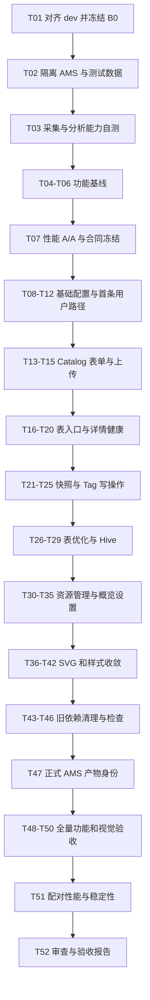

<!--
  Licensed to the Apache Software Foundation (ASF) under one
  or more contributor license agreements. See the NOTICE file
  distributed with this work for additional information
  regarding copyright ownership. The ASF licenses this file
  to you under the Apache License, Version 2.0 (the
  "License"); you may not use this file except in compliance
  with the License. You may obtain a copy of the License at

    http://www.apache.org/licenses/LICENSE-2.0

  Unless required by applicable law or agreed to in writing,
  software distributed under the License is distributed on an
  "AS IS" BASIS, WITHOUT WARRANTIES OR CONDITIONS OF ANY
  KIND, either express or implied. See the License for the
  specific language governing permissions and limitations
  under the License.
-->

# 实施计划：Amoro Dashboard 迁移至 Element Plus 2.14.8

- 更新：2026-11-20，Asia/Singapore。迁移代码已实施，Chrome 本地回归和两项主性能目标已通过。
- 需求依据：[`SPEC-element-plus-migration.md`](../SPEC-element-plus-migration.md)。功能不变优先于性能；不变更已确认的视觉边界和两项至少 10% 收益门槛。
- 迁移分支为 `codex/element-plus-migration`。实施底座为 `sl/dev` 的 `591b90ca5`。
- 工作目录：`/Users/SL/.codex/worktrees/element-plus-migration/amoro`。
- 实施状态记录在 [任务清单](todo.md)。本次修订更新版本、上游基准、分发命令与回归用例。

## 1. 基线与交付边界

2026-11-20，迁移分支已对齐到远端 `sl/dev` 的 `591b90ca5875d748eb0fd9ddcea481112781f76c`。该提交是本轮 B0。按其 Maven POM 使用 Node 22.23.2、pnpm 9.6.0，并以 JDK 11 构建两端发行包。

1. T01 在实施开始时读取 `sl/dev`，对齐分支并冻结仍使用旧 UI 的 Amoro 提交 **B0**。记录 upstream SHA、前端树、锁文件、Maven 版本、后端和 fixture。
2. 候选 **M** 只在 B0 上修改本轮前端代码。B0 与 M 使用同一后端源码、构建参数和独立数据快照，不拿历史发行包与新后端比较性能。
3. B0 冻结后若再整合上游，重新检查功能清单与测试数据，重建两端并重跑基线；旧样本不可直接沿用。
4. 不修改现有 MR !66。后续提交、推送和新 MR 按用户后续指令处理；本轮不做外部发布。

目标是按原功能、权限、API、布局和交互契约，替换四个旧直接依赖及其使用点。精确锁定 `element-plus@2.14.8` 和 `@element-plus/icons-vue@2.3.2`。基础依赖与工具链按 B0 版本参与对照，新增传递依赖依据发布声明和 pnpm 生成的锁文件核验。具体版本与兼容声明见 [Spec §2](../SPEC-element-plus-migration.md#2-现状与事实依据)。

## 2. 架构决策与兼容策略

### D01：按完整用户路径迁移，短期共存、最终移除

T08 起暂时保留旧库/旧 resolver，同时加入 Element Plus；每次迁移某个路径的模板、类型、图标、反馈和局部样式，并验证该路径仍可操作。旧页面继续走原实现，避免全局替换后长期不可运行。此共存仅用于迁移，不用于正式性能结论或最终分发；T41/T43 清除旧 SVG 插件、旧库及其 resolver/chunk/无用途补丁，T46 确认依赖图和产物不存在旧实现。

使用既有 `unplugin-vue-components@32.1.0`，模板组件和指令通过 `ElementPlusResolver({ importStyle: 'css' })` 按需导入。JS API 和图标显式导入，按调用补齐对应的 CSS。T08 实测解析器生成的导入、Message/MessageBox/Loading 样式及中英文 locale 入口。[固定版本按需导入说明](https://github.com/element-plus/element-plus/blob/2.14.8/docs/en-US/guide/quickstart.md)

### D02：只做必要的语义适配，不建立第二套 UI 框架

- `src/utils/ui-feedback.ts` 仅集中 Message 与简单确认/告警的调用、必要 CSS 和取消结果；不复制完整 Ant Design Modal API。复杂表单使用业务组件内的 ElDialog，保留原有 busy、确认快照、错误和关闭决策。
- 标准 `ElTable` / `ElTableColumn` 为默认；逐列适配 `dataIndex/bodyCell/customRender`，保留 row key、展开、宽度、排序/分页、tooltip、空值及行点击。没有证据不引入 Table V2，不创建仿 Ant Design Table 的通用壳层。
- 保留 `usePagination()` 的业务状态，不全仓改变页大小。视图把原字符串 options 转为 Element Plus 数字选项；通过单一事件出口更新 page/pageSize 并调用原 handler，防止同时监听多个分页事件产生双请求。Operations/资源默认 25、Tag 默认 20 等差异逐处保留。
- 表单 `name` 转 `prop` 时保留数组路径。例如 Catalog 的 `['storageConfig', 'storage.type']` 中第二段是字面点号键，不能改成会被拆解的 `storageConfig.storage.type`。校验、reset、空值和上传绑定均沿用原业务约束。
- 原 `destroy-inactive-tab-pane` 不能简单替换成 ElTabPane 的 lazy：在对应内容层按活动 key 显式控制卸载，保留标签头及原有请求/状态生命周期；没有销毁语义的页面不额外卸载。
- Selector 的 branch/tag/consumer 多标签内容用 ElPopover 承载，保留内部搜索/分页/待处理禁用；Topbar 的简单命令菜单使用 ElDropdown。核查 teleport、滚动容器、事件冒泡和关闭焦点。

新版发布说明对应到以下用例。T10、T24、T25 验证 Dialog 自定义标题和焦点。T11 验证侧栏折叠、选中和间距稳定。T14、T25 验证动态禁用、Select 候选和 InputNumber 的 ARIA。T19 验证已使用的不同表类型和字段列切换后表头及 slot 同步更新。T48–T50 在正式 AMS 复测关联路径。[2.14.8 发布说明](https://github.com/element-plus/element-plus/releases/tag/2.14.8)

### D03：主题与 locale 保留产品上下文

`App.vue` 使用 ElConfigProvider 的中英文 locale，继续由 Vue I18n 和 Day.js 联动；**过渡期同时保留嵌套的旧 ConfigProvider 并同步语言，避免未迁移页面失去中文**，T43 清除最后旧使用点后再移除旧 provider/locale。命令式反馈在调用时获取当前上下文。主题通过预编译 CSS 和项目 CSS 变量表达，现有 Less 保留。保留暗色侧栏、页面间距和操作布局，分批删除 `.ant-*` 内部类依赖，最后移除旧覆盖表；先检查 reset 对新控件、ECharts 与 Swagger 的影响。Vite 的 Less `modifyVars` 按项目实际引用处理，不能因变量曾用于 Ant Design 就删除仍被业务样式使用的颜色/尺寸值。

### D04：复制优先使用平台 API，保留 HTTP 能力

`src/utils/clipboard.ts` 为一个窄接口：成功才 resolve，失败 reject。优先 Clipboard API，不支持或拒绝时使用受控兼容路径；校验 `execCommand` 返回值，finally 清理节点、焦点与选区。先在 Operations 路径验证多行/Unicode/长文本及失败，后复用于 Optimizer 地址的 `Typography.Text copyable` 等实际复制用法。不引入新的剪贴板包，不把 localhost 成功当作普通 HTTP 兼容证明。

### D05：保留请求、能力和业务模型

不改路由/权限模块、REST 协议、Java/DB、Tag 观察 token 与保留期规则、snapshot ID 字符串、时间单位/时区。请求模块只适配消息 import/call，不顺手修复已有取消 Promise、历史显示或数据语义问题。性能优化仅针对重复 UI 计算、稳定 props、无用挂载、按需资源和已定位的渲染瓶颈，不删必要请求、不改变缓存失效和数据完整性。

### D06：SVG 采用本地原生 Vue SVG 组件，保留图标接口

将 16 个本地 SVG 保留在原素材目录，并将其形状、颜色和 `viewBox` 合并到 `src/assets/icons/sprite.svg`。Vite 通过 `?no-inline` 将 sprite 作为带内容哈希的同源静态资源输出，`svg-icon.vue` 用原生 `<use>` 引用固定资源中的 symbol。保留原来的 iconClass/className/isStroke/disabled、样式与点击逻辑。

每个 symbol 内部 ID 加素材名前缀，同时改写 clipPath 等引用。多个实例共享同一个外部 symbol，避免在页面重复声明局部 ID。T40 对照全部素材、重复实例和未知名称后，T41 核查旧插件入口、类型、依赖和供给补丁。实际字节、解析与绘制成本以构建和浏览器测量为准。

## 3. 依赖图与执行顺序



默认按编号执行，`todo.md` 的显式依赖是最低约束。每 2–3 项设检查点，失败先修复，不把问题堆到最终集成。核心用户路径以浏览器回放和真实响应验收；资源管理等模块迁移的顺序不改变用户入口。

| 阶段 | 任务 | 输出/退出条件 |
|---|---|---|
| 准备与基线 | T01–T07 | B0、迁移清单、可重放 fixture、功能对照、可测的 P1/P2、有效 A/A 样本；未就绪不迁移 |
| 首条路径 | T08–T12 | 严格依赖安装；登录→导航→表操作详情复制可用，反馈/locale/loading 无回归 |
| Catalog 与表详情 | T13–T20 | Catalog 校验/上传和完整保存；表树/数据库/表创建、详情与健康路径可用 |
| 快照/Tag/Hive | T21–T29 | bounded/legacy、Files、Tag 写入及保留期、优化和 Hive 路径逐项通过 |
| 其余管理功能 | T30–T35 | 所有资源页、Overview、Settings 等效；不恢复旧路由 |
| SVG 与依赖收敛 | T36–T46 | 16 个素材、全部旧使用点、样式、旧包和许可差异闭环；正式构建可复现 |
| 真机验收与审查 | T47–T52 | 同后端 AMS 正式产物、覆盖矩阵、10% 两项收益和无回归证据；可供审阅 |

T04–T06 建立的用例分组随对应路径持续回放。52 个任务都未开始；不把本轮“已写计划”计为任何实施任务完成。

## 4. 工作量约束与状态规则

每项任务预计修改 1–5 个源文件/受版本管理的材料；只读源文件、运行数据库、截图与 trace 不计作代码修改且不提交。大的现有文件如 Catalog Detail、TableExplorer、HealthScoreDetails 按路径或职责限制范围；实际超过一次聚焦会话或出现超过 5 个修改文件时，先在 `todo.md` 展开编号子任务、明确依赖再做，不能靠一个宽泛任务吞掉未知工作。

所有源码迁移任务默认通过两项类型检查、既有测试/正式 Vite 构建、lint 差异审查，并在对应真实 AMS 路径回放后才打勾。新增断言验证实际风险，不为控件名称写镜像测试；不得批量删除测试或全仓格式化。原有 lint 存量单独冻结，新增错误不得通过降低规则掩盖。

检查点记录 commit、命令/退出码、用例 ID、API 结果、截图/trace 链接与限制。常规检查点由实施者验证并供用户审阅，用户批准实施后的常规可回退步骤无需反复确认；仅范围/合同变化及合并/部署走相应授权。

## 5. 功能基线与数据准备

`output/element-plus-verification/` 是本地证据根目录，T01–T07 建立下列文件，后续仅填入真实结果：

| 文件/目录 | 内容 |
|---|---|
| `baseline.json`、`inventory.json` | B0/upstream/web-tree/lock/工具版本、所有模板/别名/类型/图标/样式/调用点及任务归属 |
| `fixtures.json`、`workload.json` | 数据快照 hash、catalog/格式/角色/能力、数量、固定请求集合、测量起止、缓存与视口语言配置；不含口令 |
| `parity.json` | 每项功能的入口、前提、权限、步骤、请求/结果、不变量、B0/M 证据和通过/待验收状态 |
| `tools/`、`cases/` | 固定版本浏览器工具的本地驱动、trace 分析与自测、分域回放；本轮不会生成这些实现文件 |
| `baseline/`、`candidate/`、`paired/` | 命令日志、逐次样本、截图、Console/Network、原始 trace、归因与复测 |
| `distribution/`、`report.md` | 产物/JAR/HTTP hash、模块与许可图、AC 结论及遗留风险 |

fixture 至少覆盖 Paimon、Iceberg、Hive/Mixed 当前存在的能力分支、管理员/受限角色、可写/只读、空库、长名称/大 ID、至少 1,000 个可访问节点、多页 Tag、快照/分支/文件/健康/操作记录及可执行的资源操作。通过独立本地 metastore/warehouse 和测试 Optimizer 提供真实数据，必要的测试容器只用于本地 fixture，不改后端实现；与性能无关的后台任务在两端保持同条件。

无法准备某必需格式/权限/写入场景时明确记录缺口，不把空态当覆盖、不修改 API/mock 填补正式证据；在准备检查点解决或报告具体外部阻碍。浏览器矩阵先核对项目当前支持契约；至少以同一 Chromium 完成计量，并对当前支持的 Firefox/WebKit 等代表引擎做功能回归，不因新库缩小已有支持范围。

旧 `Home.vue`、`Layout.vue`、`components/SwaggerUI.vue` 和无 Ant 控件的业务模块不要求为了迁移而修改，但必须归入回放；`views/optimize/components/List.vue` 仍被当前 Resource 导入，不能因为旧 `optimize/index.vue` 路由被注释就误判整目录无用。

## 6. 性能测量的可执行合同

### 6.1 先证明可测，再进行迁移

T03 用实际浏览器版本的 CDP Tracing 验证类别/线程/事件，不硬编码另一版本的 trace 假定。自测含嵌套事件不重复计数、微秒/毫秒与时钟对齐、缺失事件拒绝、无效/零样本、分位数与配对统计；至少人工对照一条 DevTools trace 的区间与汇总。若 parse/compile 或完成绘制帧无法观测，先修复采集，不换成 LCP、包体或两次 RAF 冒充目标指标。[CDP Tracing](https://chromedevtools.github.io/devtools-protocol/tot/Tracing/)。

T07 在 B0 上做 A/A 对照并冻结 `workload.json` 与驱动 hash，确认噪声和测量开销；最终 T51 还要交错采集新 B0/M 配对样本，不能把 T07 的旧 A 样本机械拼到未来 M。冷热、locale、视口、后端/fixture、浏览器/CPU条件和排除规则相同；驱动必须串行。

### 6.2 固定两个收益指标

- **P1**：有效登录态冷硬导航 `/#/tables` 至首批数据可操作。主线程 parse/compile 独占 CPU 时间与 evaluate/script 分列；记录请求集合、源模块、线程、单位及边界。每个冷样本使用隔离浏览器 profile/等价的经验证代码缓存清理；仅关 HTTP cache 不等于清除 V8 代码缓存。登录态来自真实 UI 登录，可恢复其会话，但不伪造角色、表或组件状态。
- **P2**：同一非空表点击 Snapshots，固定 bounded/legacy 模式、表/快照/统计数量、页大小、展开状态和全部必要请求。记录点击、最后必要响应、DOM 结果完整可操作、首个相应完成绘制帧四个时间点。收益指标是最后必要响应到相应绘制帧的区间，同时检查完整点击时延。响应与 trace 使用同一单调时间轴；若首屏已命中缓存或最后响应与有效绘制无法对应，按预先规则判无效，不临时改起点。
- P3/P4/P5 按 Spec 保留：其他关键操作 p50/p95、JS/CSS raw/gzip/传输、模块来源、脚本/style/layout/paint、长任务、LCP/CLS、10 轮往返/弹窗后的 DOM/监听/实例/内存。固定等待和动画成本单列，非 INP 指标不命名为 INP。

### 6.3 样本与判定

每端每项至少 10 个有效样本，交错配对；输出每次结果、中位数、nearest-rank p95、IQR 和噪声。10 样本的 p95 接近最大值，只作本地回归调查；不声称代表线上用户分布，噪声高时按预先扩样规则追加。

P1/P2 都要求 `(median(B0)-median(M))/median(B0) ≥ 10%`，收益超过 A/A 噪声。A/A 的 `noise95` 定义为配对 bootstrap 中 `abs((median(A1)-median(A2))/median(A1))` 的第 95 百分位，候选收益必须大于它。按配对索引 bootstrap 10,000 次，固定 seed `20261021`，估计中位数差异的 95% CI，区间跨 0 不判提升。统计实现和无效样本理由在看迁移结果前冻结；修改工具口径须两端重跑。

其他指标上升超过 `max(基线 × 10%, 16ms)` 启动归因，任何确认由迁移引入的可复现退化都阻止验收。目标未达时只基于 trace 拆出小修复任务，重跑受影响自动检查和基线/候选比较；不能降低 10%、挑页面或删信息换速度。高风险业务已等价但性能不可达时仍保持“待验收”，提交证据审阅。

## 7. 命令与验证入口

以下命令可用于复现实验和构建验证。源文件路径以当前 worktree 为准，B0 基线在独立 checkout/发行目录执行相同命令。环境先固定 Maven Node/pnpm 与可用 JDK 11 的精确路径/版本；不使用未知全局版本代替。

T08 从迁移工作树的 `amoro-web` 执行一次精确安装并生成锁文件，然后用下方命令验证。B0 直接使用其原有锁文件。

```bash
pnpm add --save-exact element-plus@2.14.8 @element-plus/icons-vue@2.3.2
```

```bash
cd /Users/SL/.codex/worktrees/element-plus-migration/amoro/amoro-web
node --version
pnpm --version
pnpm install --frozen-lockfile --strict-peer-dependencies --config.engine-strict=true
pnpm run typecheck
pnpm exec vue-tsc --noEmit -p tsconfig.node.json
pnpm run build
pnpm exec eslint ./src --format json --output-file ../output/element-plus-verification/candidate/lint.json
pnpm audit --prod --json
```

源码任务的通用检查记为 **V-web**：上面两项类型检查、`pnpm run build`（含所有既有测试）及 lint 相对 B0 的诊断比较。lint/audit 存量可能 exit 1，应保留退出码并归因；不得把非零退出直接描述为通过。相关状态测试可先聚焦运行，例如：

```bash
cd /Users/SL/.codex/worktrees/element-plus-migration/amoro/amoro-web
node --experimental-vm-modules ./scripts/dashboard-navigation.test.mjs
node ./scripts/preload-error-recovery.test.mjs
node --disable-warning=MODULE_TYPELESS_PACKAGE_JSON --experimental-strip-types --test ./scripts/tag-management-state.test.mts ./scripts/tag-snapshot-state.test.mts
```

T03 拟新增的本地工具必须实现并自测以下接口；创建前这些命令不可执行，不能记录为已验证：

```bash
cd /Users/SL/.codex/worktrees/element-plus-migration/amoro
node --test output/element-plus-verification/tools/trace-analysis.test.mjs
node output/element-plus-verification/tools/trace-capture.mjs --manifest output/element-plus-verification/workload.json --variant baseline --phase all --samples 10
node output/element-plus-verification/tools/trace-capture.mjs --manifest output/element-plus-verification/workload.json --variant paired --phase all --samples 10
node output/element-plus-verification/tools/trace-analyze.mjs --manifest output/element-plus-verification/workload.json --input output/element-plus-verification/paired/samples.json --output output/element-plus-verification/paired/summary.json
```

`cases/` 回放按功能 ID 与真实浏览器工具执行，工具版本/入口由 T02/T03 固定，不新增产品测试框架；存量测试继续进入 build，新兼容工具测试在对应任务和 T46 运行。

正式分发/启动记为 **V-dist / V-ams**：

```bash
cd /Users/SL/.codex/worktrees/element-plus-migration/amoro
CI=true ./mvnw -pl dist -am package -DskipTests
mkdir -p output/element-plus-verification/runtime
tar -xzf dist/target/apache-amoro-1.0.4-bin.tar.gz -C output/element-plus-verification/runtime
```

示例使用本次核查的 Maven 版本 `1.0.4`。按 T01 固定的 POM 与 assembly 核对文件名和解压目录，并在分发构建前清理本工作树的旧前端产物。解压后先配置独立端口、Derby/metastore/warehouse 和非默认管理员密码，再执行启动命令。正式回归用 AMS 同源访问。Vite 跨源辅助开发优先用同源代理，确需跨源时在隔离 AMS 配置精确的 Origin。T47 比对 Vite 输出、JAR static 和 HTTP 资源 hash，并验证实际登录和 API。`-DskipTests` 只用于分发组装。第三方许可依据产物核对。

```bash
bash output/element-plus-verification/runtime/amoro-1.0.4/bin/ams.sh start-foreground
```

迁移期间每条路径检查使用该次源码正式构建且身份可追溯的本地 AMS，避免每次全 reactor 重打包可复用同 B0 后端的隔离运行环境并替换正式 web 产物，但不能把这种局部验证替代 T47 最终全分发验证。

## 8. 风险与收敛规则

| 风险 | 影响 | 处理 |
|---|---|---|
| 后端/upstream 与 Spec 起点不一致 | 比较结果失真、遗漏新功能 | T01 冻结 B0，后续整合即重建比较，不混历史发行包 |
| 10% 指标不可观测/收益低于噪声 | 无法证明达成用户目标 | T03/T07 提前验证工具；P1/P2 不可替代，最终不达标不结项 |
| 双库过渡导致体积大/样式相互影响 | 中间回归、性能假结论 | 路径逐项验证，CSS 顺序隔离；最终测量必须旧依赖清理完成 |
| 表单点号键、分页双事件、Tabs 生命周期差异 | 保存错误/重复写/错误状态 | 具体路径断言、单事件出口、显式卸载，真实请求计数 |
| Tag、上传和 MessageBox 默认关闭/Promise 变化 | 假成功、重复提交、确认失效 | 原业务状态不改，慢请求/双 Enter/取消/业务失败路径验证 |
| 原生 SVG 转换丢 viewBox/clipPath/色彩 | 格式/品牌图标失真 | 四批原生模板、命名空间、16 素材对照和重复实例测试 |
| HTTP 复制被安全上下文限制 | 旧部署失去复制功能 | 普通 HTTP 实测、平台 API 拒绝/不支持与兼容返回值检查 |
| 多格式/权限 fixture 不齐 | 假回归通过 | 准备阶段记录全部缺口，缺项保持待验收，不缩减合同 |
| 许可证/预打包 Swagger 依赖被误删 | 分发材料不完整 | 以输出模块和嵌入包为准，T44/T45 精确处理，不全目录清空 |
| 大文件任务膨胀/共享文件冲突 | 不可审查、状态丢失 | 单任务 1–5 文件，超出先分解；默认串行，不自动启动其他代理 |

没有新增需要用户先回答的产品偏好问题；存在待实施确认的工具、fixture 和性能可达性问题，均有前置任务和失败出口，不能写成已验证事实。

## 9. 回退、审查与最终交付

每个通过检查点保存可回退本地提交与对应运行产物。失败回退该片段的代码/依赖/锁文件组合，保护其他 worktree 和未提交内容；已执行的本地写入通过 fixture 快照恢复，不修改共享或生产数据。最终回退以 B0 web/发行包为单位，不把旧库作为长期运行时开关带入产品。

T52 的审查验证功能/API/权限不变量、复杂度、性能归因、输入与资源处理、维护成本、许可和回退证据。Spec AC 对应任务：

| Spec AC | 主要任务 | 必备证据 |
|---|---|---|
| AC-01 | T01、T08、T41、T43、T46 | 精确版本、严格安装、锁/模块/旧包路径 |
| AC-02 | T04–T06、T10–T35、T48–T50 | 功能对照、真实请求与刷新状态 |
| AC-03 | T08–T45 | 逐文件库存、组件/图标/样式清零与兼容结果 |
| AC-04 | T03、T07–T46 | 命令退出码、既有/新增测试、lint 差异、构建 |
| AC-05 | T02、T47–T50 | AMS PID/JDK/commit、HTTP/JAR hash、真实 API |
| AC-06 | T11–T42、T50 | 中英文、两视口及适用状态截图和操作 |
| AC-07 / AC-08 | T03、T07、T51 | 配对原始样本/trace/统计与两项 ≥10% |
| AC-09 | T04–T51 | Console/Network、长任务、重复操作与历史/新增问题分列 |
| AC-10 | T44–T47、T52 | 实际分发许可、审计、完整报告、提交卫生 |

常规检查点共 17 个（每 3 项），T52 另有最终审阅检查点；具体勾选项在 todo。当前仅交付 Plan/Tasks 与 Spec 状态更新；用户审阅该计划后再实施，不因为完成文档就把任何 AC 标为通过。

### 参考

- 本地固定提交的源码、Spec 和实际目录清单是任务拆分依据；历史归档仅提供线索，不代替 B0 实测。
- [Element Plus 2.14.8 元数据](https://registry.npmjs.org/element-plus/2.14.8) · [图标 2.3.2 元数据](https://registry.npmjs.org/@element-plus/icons-vue/2.3.2)
- [2.14.8 Form](https://github.com/element-plus/element-plus/blob/2.14.8/docs/en-US/component/form.md) · [Tabs](https://github.com/element-plus/element-plus/blob/2.14.8/docs/en-US/component/tabs.md) · [Dialog](https://github.com/element-plus/element-plus/blob/2.14.8/docs/en-US/component/dialog.md) · [MessageBox](https://github.com/element-plus/element-plus/blob/2.14.8/docs/en-US/component/message-box.md)
- [Vite 本地导入/编译机制](https://vite.dev/guide/features.html)、[Clipboard API](https://developer.mozilla.org/en-US/docs/Web/API/Clipboard/writeText)。
